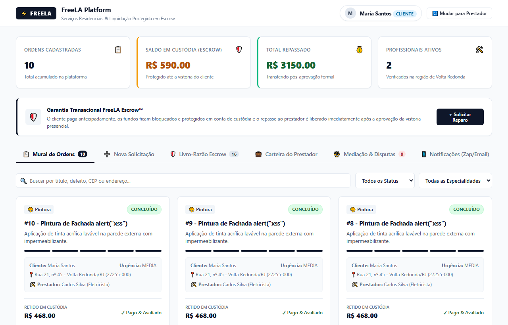
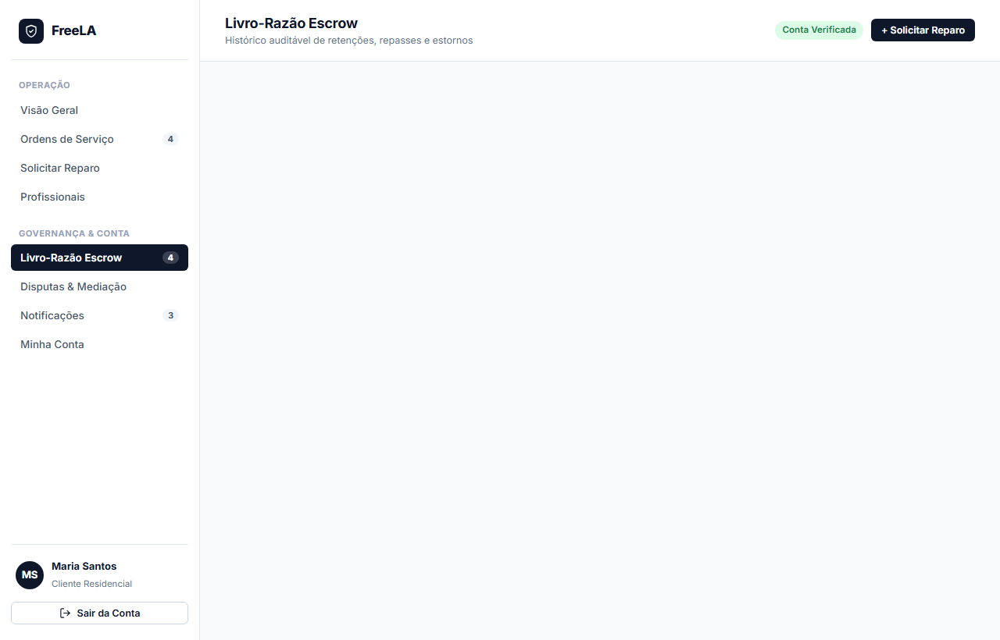
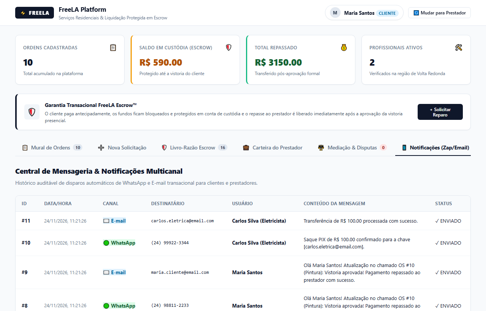

# FreeLA: Plataforma de Serviços com Garantia Escrow

O FreeLA intermedia serviços residenciais e reparos manuais. A plataforma utiliza um motor de custódia financeira (Escrow) que retém o pagamento do cliente. O repasse financeiro ao prestador ocorre apenas após a vistoria presencial e a aprovação formal do cliente.

---

## 1 Visão Geral do Produto

A contratação informal de serviços manuais (eletricistas, encanadores, pintores, pedreiros) gera desconfiança mútua. Clientes temem prejuízos por serviços incompletos ou mal executados. Prestadores autônomos enfrentam inadimplência e atrasos no pagamento após a entrega da mão de obra.

O **FreeLA** soluciona esse problema através da garantia transacional:
* O cliente aceita o orçamento e efetua o pagamento antecipado via PIX ou Cartão de Crédito.
* O sistema retém o valor integral em conta de custódia protegida (Escrow).
* O prestador realiza o reparo com a certeza do recurso garantido.
* O cliente inspeciona o resultado presencialmente e homologa a vistoria no aplicativo.
* O motor de escrow libera o repasse imediatamente para a carteira digital do prestador.
* Caso ocorram inconformidades, a plataforma disponibiliza mediação e estorno integral.

**Parceiro Extensionista:** Comunidade de Moradores e Profissionais Autônomos de Volta Redonda/RJ (Práticas Extensionistas Integradoras III: Engenharia de Software, Centro Universitário de Barra Mansa: UBM, 2026).

---

## 2 Tecnologias Utilizadas

| Tecnologia | Versão | Função na Arquitetura |
|---|---|---|
| **Node.js** | `>= 22.5.0` (LTS) | Ambiente de execução JavaScript no servidor |
| **Express** | `4.21.2` | Framework para construção dos endpoints da API REST |
| **SQLite (`node:sqlite`)** | Nativo | Mecanismo relacional embutido com transações ACID |
| **Helmet** | `8.0.0` | Middleware de cabeçalhos HTTP para proteção contra ataques OWASP |
| **Express Rate Limit** | `7.5.0` | Proteção contra sobrecarga de requisições (DoS e força bruta) |
| **Dotenv** | `16.4.7` | Gerenciamento seguro de variáveis de ambiente |
| **HTML5 / CSS3 / JS** | Padrão W3C | Interface SPA modular (Vanilla CSS3/BEM, sem dependências externas) |
| **CORS** | `2.8.5` | Controle de compartilhamento de recursos entre origens |

---

## 3 Pré-requisitos e Ambiente

Para executar o FreeLA localmente, instale os seguintes requisitos:

1. **Node.js versão 22.5.0 ou superior** (Recomendado Node.js 22 LTS ou 24 LTS):
   * O projeto utiliza a biblioteca nativa `node:sqlite`. Essa biblioteca requer o Node.js `>= 22.5.0`.
   * Verifique sua versão no terminal: `node --version`.
   > [!NOTE]
   > No Node.js 22, o runtime exibe a mensagem informativa `ExperimentalWarning: SQLite is an experimental feature`. Esse aviso confirma o carregamento do módulo nativo e não interfere na execução estável da aplicação.

2. **Git versão 2.x ou superior**:
   * Verifique sua versão no terminal: `git --version`.

3. **Navegador Web Moderno** (Google Chrome, Microsoft Edge, Mozilla Firefox ou Safari).

---

## 4 Instalação Passo a Passo

1. Clone o repositório oficial no terminal:
   ```bash
   git clone https://github.com/ViniMSimoes/freela.git
   cd freela
   ```

2. Instale as dependências declaradas no projeto:
   ```bash
   npm install
   ```

3. Configure o arquivo de variáveis de ambiente:
   ```bash
   # No Linux ou macOS:
   cp .env.example .env

   # No Windows PowerShell:
   Copy-Item .env.example .env
   ```

4. Variáveis de ambiente configuráveis no `.env`:

| Variável | Padrão | Descrição |
|---|---|---|
| `PORT` | `3000` | Porta TCP onde o servidor Express atenderá as requisições HTTP |
| `NODE_ENV` | `development` | Identificador do ambiente de execução |
| `DB_PATH` | `./freela.db` | Caminho do arquivo de banco de dados SQLite local |

O banco de dados SQLite (`freela.db`) cria suas tabelas e insere dados iniciais (seed) automaticamente na primeira inicialização.

---

## 5 Como Executar a Aplicação

Inicie o servidor HTTP:

```bash
npm start
```

Para desenvolvimento com reinicialização automática mediante alterações no código:

```bash
npm run dev
```

O terminal exibirá a confirmação de inicialização segura:

```text
====================================================
 FreeLA SaaS (Hardened) — Servidor Ativo na porta 3000
 Proteções ativas: Helmet, Rate Limiting, Sanitização
 Acesse no navegador: http://localhost:3000
====================================================
```

Abra seu navegador no endereço: **`http://localhost:3000`**

---

## 6 Capturas Reais da Aplicação

### Mural de Ordens e Indicadores (Dashboard)
Interface principal com métricas financeiras de custódia, filtros por especialidade e barra de progresso operacional das ordens de serviço:


### Livro-Razão de Custódia (Escrow Ledger)
Auditoria transacional detalhada com registro de retenções (`BLOQUEIO_ESCROW`), liberações (`LIBERACAO_REPASSE`) e estornos:


### Carteira Digital do Prestador e Saque PIX
Visualização de saldos operacionais (disponível vs. em garantia) e formulário de resgate financeiro instantâneo via PIX:


### Central de Mensageria e Notificações Multicanal
Registro auditável de disparos de notificações automáticas via WhatsApp e E-mail transacional para clientes e prestadores:


---

## 7 Suíte de Testes Automatizados

O sistema inclui 16 testes automatizados de integração que cobrem os requisitos de negócio, segurança OWASP, controle de concorrência e integridade referencial:

Execute os testes com o comando:

```bash
npm test
```

Saída oficial do terminal:

```text
======================================================
 SUÍTE DE TESTES RIGOROSOS — FREELA ESCROW SAAS (C1-C4)
======================================================

• Teste 1: GET /api/stats (Estatísticas do Dashboard)
  ✓ Estatísticas retornadas com sucesso.
• Teste 2: Verificação de Cabeçalhos HTTP de Segurança (Helmet & OWASP)
  ✓ Cabeçalhos de segurança ativos (X-Content-Type-Options: nosniff, X-Powered-By omitido).
• Teste 3: GET /api/usuarios (Listagem de Usuários e Perfis)
  ✓ Total de usuários listados: 3.
• Teste 4: GET /api/ordens (Listagem de Chamados com Filtros)
  ✓ Total de ordens listadas: 9
• Teste 5: POST /api/ordens (Criação de Chamado com Defesa XSS)
  ✓ Ordem criada com ID #10 e payload malicioso sanitizado com sucesso.
• Teste 6: POST /api/ordens/:id/propostas (Validação Estrita de Valor Negativo)
  ✓ Proposta com valor negativo bloqueada com sucesso (HTTP 400).
• Teste 7: POST /api/ordens/:id/propostas (Registro de Proposta Válida)
  ✓ Proposta #8 registrada com sucesso.
• Teste 8: POST /api/ordens/:id/checkout (Bloqueio Transacional em Escrow)
  ✓ Valor total R$ 468 retido com sucesso na custódia segura.
• Teste 9: POST /api/ordens/:id/checkout (Proteção Anti Double-Spending)
  ✓ Tentativa de pagamento duplo bloqueada com sucesso (HTTP 400).
• Teste 10: POST /api/ordens/:id/aprovar (Bloqueio de Aprovação em EM_EXECUCAO)
  ✓ Tentativa de liberação de repasse durante EM_EXECUCAO bloqueada (HTTP 400).
• Teste 11: POST /api/ordens/:id/aprovar (Validação de Titularidade - HTTP 403)
  ✓ Tentativa de aprovação por usuário não-titular rejeitada com HTTP 403 Forbidden.
• Teste 12: POST /api/ordens/:id/aprovar (Homologação Legítima e Repasse)
  ✓ Vistoria homologada! R$ 450 liberados à carteira do prestador.
• Teste 13: GET /api/transacoes (Livro-Razão Escrow Auditável)
  ✓ Total de movimentações auditadas no livro-razão: 16
• Teste 14: POST /api/prestador/saque (Resgate via PIX)
  ✓ Saque PIX processado com sucesso. Novo saldo disponível: R$ 3800
• Teste 15: GET /api/notificacoes (Log Auditável de Mensageria)
  ✓ Log de mensageria ativo com 11 notificações registradas (WhatsApp/Email).
• Teste 16: PRAGMA foreign_keys = ON (Enforcement Estrito de Chaves Estrangeiras)
  ✓ Inserção com chave estrangeira inexistente rejeitada pelo SQLite (Integridade ativa).

======================================================
 TODOS OS 16 TESTES PASSARAM COM 100% DE SUCESSO!     
======================================================
```

---

## 8 Estrutura de Diretórios do Projeto

```text
freela/
├── docs/                                # Documentação técnica de engenharia
│   ├── img/                             # Diagramas e capturas reais da aplicação
│   │   ├── diagrama_der.png             # Modelo Lógico Entidade-Relacionamento
│   │   ├── diagrama_componentes.png     # Arquitetura de Componentes e Serviços
│   │   ├── print_mural.png              # Interface do mural e métricas
│   │   ├── print_escrow.png             # Interface do livro-razão de custódia
│   │   ├── print_carteira.png           # Interface da carteira digital e saque PIX
│   │   └── print_notificacoes.png       # Interface de logs WhatsApp & E-mail
│   ├── manual-tecnico-parcial.md        # Manual Técnico Parcial (Arquitetura e API)
│   ├── backlog-atualizado.md            # Product Backlog versão 2.0 priorizado
│   └── estrutura-banco-de-dados.md      # Documentação formal do banco de dados (DER/DDL)
├── public/                              # Camada de apresentação SPA (Frontend)
│   ├── css/
│   │   └── style.css                    # Folha de estilos arquitetônica e neutra
│   ├── js/
│   │   └── app.js                       # Controlador client-side e integração REST
│   └── index.html                       # Marcação estrutural semântica HTML5
├── src/                                 # Camada de serviços e regras de negócio (Backend)
│   ├── controllers/
│   │   └── ordensController.js          # Orquestrador HTTP de ordens e chamadas
│   ├── database/
│   │   ├── connection.js                # Inicializador SQLite e ativação de foreign keys
│   │   └── schema.sql                   # Estrutura DDL relacional em 3FN
│   ├── routes/
│   │   └── api.js                       # Definição e roteamento dos endpoints da API
│   ├── services/
│   │   ├── escrowService.js             # Motor desacoplado de custódia financeira
│   │   └── notificationService.js       # Serviço multicanal de mensagens (Zap/Email)
│   └── server.js                        # Inicialização do Express com middlewares de segurança
├── tests/
│   └── api.test.js                      # Suíte de 16 testes automatizados de integração
├── .env.example                         # Modelo de configuração de variáveis de ambiente
├── .gitignore                           # Regras de exclusão do controle de versão
├── LICENSE                              # Termo de licença MIT
├── package.json                         # Manifesto de pacotes e scripts do Node.js
└── README.md                            # Guia principal de introdução e operação
```

---

## 9 Documentos Técnicos da Disciplina

* [Manual Técnico Parcial (Arquitetura & API REST)](docs/manual-tecnico-parcial.md)
* [Product Backlog Atualizado Versão 2.0](docs/backlog-atualizado.md)
* [Estrutura do Banco de Dados & DER Relacional](docs/estrutura-banco-de-dados.md)
* [Diagrama Entidade-Relacionamento (DER)](docs/img/diagrama_der.png)
* [Diagrama de Arquitetura de Componentes](docs/img/diagrama_componentes.png)

---

## 10 Integrantes da Equipe

| Integrante | GitHub |
|---|---|
| Vinicius Marcello Simoes | [@ViniMSimoes](https://github.com/ViniMSimoes) |
| Kaique | [@kaique](https://github.com) |
| Caio | [@caio](https://github.com) |
| Yago | [@yago](https://github.com) |
| Lucas Augusto | [@lucasaugusto](https://github.com) |
| Lucas Gabriel | [@lucasgabriel](https://github.com) |

---

## 11 Licença

Este projeto é distribuído sob a licença [MIT](LICENSE).

**Centro Universitário de Barra Mansa (UBM)**  
Curso de Engenharia de Software: Práticas Extensionistas Integradoras III (2026)  
Orientação: Profa. Ma. Laila Alves Santos
