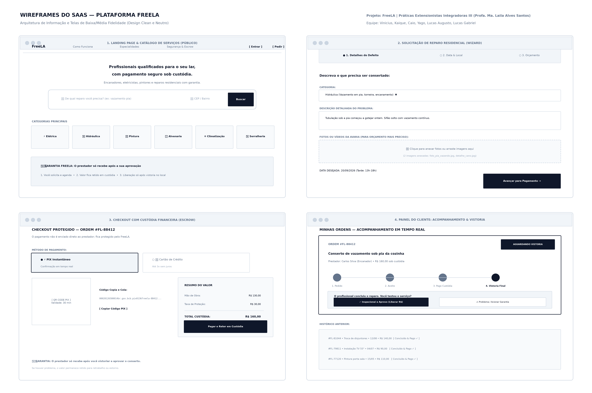

# FreeLA

Plataforma SaaS de intermediação de serviços manuais e reparos residenciais com pagamento protegido em custódia (Escrow) até a vistoria e aprovação final do cliente.

## Documentação da Entrega — Critérios de Avaliação (13/11)

| Critério | O que foi entregue | Onde encontrar no repositório | Avaliação Alvo |
|---|---|---|:---:|
| **C1. Repositório no GitHub** | Repositório público ativo, commits regulares distribuídos entre os integrantes da equipe com mensagens semânticas | [Histórico de Commits](https://github.com/ViniMSimoes/freela/commits/main) | **Completo (1,5 pts)** |
| **C2. README e Manual Técnico Parcial** | README completo com passos de execução testados do zero e manual técnico aprofundado com Arquitetura (Opção C) e API (Opção B1) | [README.md](README.md) e [Manual Técnico Parcial](docs/manual-tecnico-parcial.md) | **Completo (1,5 pts)** |
| **C3. Product Backlog Atualizado** | Backlog versão 2.0 priorizado, detalhando o que mudou desde 16/10, itens entregues no MVP e rastreabilidade com testes | [Backlog Atualizado](docs/backlog-atualizado.md) | **Completo (1,0 pt)** |
| **C4. Estrutura do Banco de Dados** | Modelagem relacional SQLite com DER/MER, integridade referencial, dicionário de tabelas e coerência com diagramas | [Estrutura do Banco de Dados](docs/estrutura-banco-de-dados.md) e [schema.sql](src/database/schema.sql) | **Completo (1,0 pt)** |

## Sobre o projeto

A contratação informal de serviços manuais residenciais (como eletricistas, encanadores, pintores e pedreiros) gera constante insegurança financeira para ambas as partes: clientes temem pagar adiantado e receber um serviço mal executado ou abandonado, enquanto prestadores autônomos sofrem com calotes e atrasos após realizarem a mão de obra.

O **FreeLA** resolve esse gargalo através de um mecanismo transacional de **custódia financeira (Escrow)**. O cliente realiza o pagamento no momento do aceite da proposta, mas o valor permanece retido e bloqueado pela plataforma. O repasse financeiro para o prestador só é liberado após a conclusão do serviço e a vistoria presencial aprovada pelo próprio cliente no aplicativo.

Parceiro extensionista: Comunidade de Moradores e Profissionais Autônomos de Volta Redonda/RJ (Práticas Extensionistas Integradoras III — UBM).

## Tecnologias

| Tecnologia | Versão | Para que serve no projeto |
|---|---|---|
| Node.js | 24.18.0 (LTS) | Ambiente de execução JavaScript no servidor |
| Express | 4.21.2 | Framework web minimalista para construção da API REST |
| SQLite | 3 (`node:sqlite`) | Banco de dados relacional embutido para persistência transacional |
| HTML5 / CSS3 / JS | Padrão W3C | Interface web SPA limpa, intuitiva e sem dependências pesadas |
| CORS | 2.8.5 | Middleware para controle de acesso HTTP e segurança |

## Pré-requisitos

Antes de iniciar, certifique-se de ter instalado em seu computador:

- **Node.js** versão 20.x ou superior (recomendado 24.x) — [Download oficial do Node.js](https://nodejs.org/)
  - Para conferir no terminal: `node --version`
- **Git** versão 2.x ou superior — [Download oficial do Git](https://git-scm.com/)
  - Para conferir no terminal: `git --version`

## Instalação

1. Clone o repositório:

   ```bash
   git clone https://github.com/ViniMSimoes/freela.git
   cd freela
   ```

2. Instale as dependências do projeto:

   ```bash
   npm install
   ```

3. O banco de dados relacional SQLite (`freela.db`) é criado e populado automaticamente com dados de exemplo (usuários, ordens ativas e transações) na primeira inicialização da aplicação.

## Configuração

Copie o arquivo de variáveis de ambiente de exemplo:

```bash
cp .env.example .env
```

*(No Windows PowerShell, você pode usar: `Copy-Item .env.example .env`)*

| Variável | Obrigatória? | Exemplo | Descrição |
|---|---|---|---|
| `PORT` | Não | `3000` | Porta HTTP em que o servidor web e a API estarão disponíveis |
| `NODE_ENV` | Não | `development` | Ambiente de execução (`development` ou `production`) |
| `DB_PATH` | Não | `./freela.db` | Caminho do arquivo de banco de dados SQLite local |

## Como executar

Para iniciar a aplicação em modo de produção:

```bash
npm start
```

Para iniciar em modo de desenvolvimento com recarregamento automático:

```bash
npm run dev
```

Quando a inicialização for concluída, você verá no terminal a mensagem:

```text
====================================================
 FreeLA SaaS — Servidor Ativo na porta 3000
 Acesse no navegador: http://localhost:3000
 API REST base: http://localhost:3000/api/ordens
====================================================
```

Abra o seu navegador e acesse: **`http://localhost:3000`**

## Exemplo de uso

O fluxo principal do FreeLA cobre o ciclo completo de contratação protegida:

1. **Visão do Cliente:**
   - Acesse `http://localhost:3000`.
   - Clique em **"+ Solicitar Reparo"** e preencha a categoria (*ex.: Elétrica*), descrição do defeito, CEP e urgência.
   - A ordem entra no mural com status **Pendente**.

2. **Visão do Prestador:**
   - Clique no botão superior **"Alternar para Prestador (Carlos)"**.
   - No card da ordem aberta, clique em **"Enviar Orçamento"**, defina o valor da mão de obra (ex.: `R$ 220,00`) e o prazo estimado.

3. **Aceite e Pagamento em Custódia (Escrow):**
   - Retorne para a visão do Cliente e clique em **"Ver Propostas"**.
   - Clique em **"Contratar com Custódia Protegida (Escrow)"**. O pagamento é retido pela plataforma e o status avança para **Em Custódia**.

4. **Execução e Conclusão:**
   - O prestador atualiza o chamado: **"A Caminho"** ➔ **"Iniciar Reparo"** ➔ **"Concluir Reparo"**.
   - O status avança para **Vistoria Pendente**.

5. **Vistoria e Liberação Financeira:**
   - O cliente avalia presencialmente o conserto e clica em **"Aprovar & Liberar"**.
   - O motor financeiro executa a liquidação automática: os fundos custodiados são transferidos para o saldo disponível do prestador e a avaliação por estrelas é registrada.



## Testes

O projeto conta com uma suíte de testes de integração automatizados que verifica todas as 7 etapas críticas da API REST (estatísticas, listagem, criação de ordem, proposta, retenção no escrow, transições de status e aprovação de vistoria com repasse).

Para executar os testes:

```bash
npm test
```

Resultado esperado no terminal:

```text
--- INICIANDO TESTES AUTOMATIZADOS DO FREELA MVP ---
• Teste 1: GET /api/stats -> ✓ Estatísticas retornadas com sucesso.
• Teste 2: GET /api/ordens -> ✓ Total de ordens listadas
• Teste 3: POST /api/ordens -> ✓ Ordem criada com ID
• Teste 4: POST /api/ordens/:id/propostas -> ✓ Proposta registrada
• Teste 5: POST /api/ordens/:id/checkout -> ✓ Valor retido na custódia segura
• Teste 6: PATCH /api/ordens/:id/status -> ✓ Ordem avançada para AGUARDANDO_VISTORIA
• Teste 7: POST /api/ordens/:id/aprovar -> ✓ Vistoria aprovada e saldo liberado

======================================================
 TODOS OS 7 TESTES AUTOMATIZADOS PASSARAM COM SUCESSO! 
======================================================
```

## Estrutura do projeto

```text
freela/
├── docs/
│   ├── img/                           # Diagramas de arquitetura, UML, BPMN e wireframes
│   │   ├── diagrama_bpmn.png          # Processo de negócio em BPMN 2.0
│   │   ├── diagrama_classes.png       # Modelo de classes de domínio
│   │   ├── diagrama_componentes.png   # Diagrama de componentes (Aula 7)
│   │   └── wireframe_board.png        # Telas e fluxo da aplicação
│   └── manual-tecnico-parcial.md      # Manual técnico detalhado (Arquitetura e API)
├── public/                            # Interface web SPA do frontend
│   ├── css/
│   │   └── style.css                  # Estilos limpos e neutros de alto contraste
│   ├── js/
│   │   └── app.js                     # Controlador do frontend e consumo da API REST
│   └── index.html                     # Estrutura HTML5 da aplicação
├── src/                               # Código-fonte do backend
│   ├── controllers/
│   │   └── ordensController.js        # Lógica de negócio, máquina de estados e custódia
│   ├── database/
│   │   ├── connection.js              # Conexão e rotina de seed com SQLite nativo
│   │   └── schema.sql                 # Modelo relacional de tabelas
│   ├── routes/
│   │   └── api.js                     # Definição dos endpoints RESTful
│   └── server.js                      # Configuração e inicialização do Express
├── tests/
│   └── api.test.js                    # Testes automatizados ponta a ponta da API
├── .env.example                       # Modelo de variáveis de ambiente
├── .gitignore                         # Arquivos ignorados pelo controle de versão
├── LICENSE                            # Licença de código aberto (MIT)
├── package.json                       # Metadados e dependências do projeto
└── README.md                          # Este documento
```

## Documentação complementar

- [Manual Técnico Parcial (Arquitetura & API)](docs/manual-tecnico-parcial.md)
- [Estrutura do Banco de Dados & DER (Critério C4)](docs/estrutura-banco-de-dados.md)
- [Product Backlog Atualizado Versão 2.0 (Critério C3)](docs/backlog-atualizado.md)
- [Relatório de Auditoria de Segurança & Hardening](docs/relatorio-auditoria-seguranca.md)
- [Diagrama Entidade-Relacionamento (DER)](docs/img/diagrama_der.png)
- [Diagrama de Componentes](docs/img/diagrama_componentes.png)
- [Diagrama de Classes de Domínio](docs/img/diagrama_classes.png)
- [Diagrama BPMN 2.0 do Processo de Negócio](docs/img/diagrama_bpmn.png)

## Equipe e licença

| Integrante | Papel no projeto | GitHub |
|---|---|---|
| Vinicius Marcello Simoes | Engenharia de Software / Arquitetura & Backend | [@ViniMSimoes](https://github.com/ViniMSimoes) |
| Kaique | Modelagem de Processos & Regras de Negócio (BPMN) | [@kaique](https://github.com) |
| Caio | Engenharia de Requisitos & Casos de Uso | [@caio](https://github.com) |
| Yago | Modelagem Relacional & Banco de Dados | [@yago](https://github.com) |
| Lucas Augusto | Frontend & Experiência do Usuário (UI/UX) | [@lucasaugusto](https://github.com) |
| Lucas Gabriel | Qualidade de Software, Testes & Documentação | [@lucasgabriel](https://github.com) |

Licença: [MIT](LICENSE)

Projeto desenvolvido na disciplina **Práticas Extensionistas Integradoras III — Engenharia de Software**, Centro Universitário de Barra Mansa (UBM), 2026.
Orientação: Profa. Ma. Laila Alves Santos.
