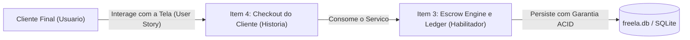

# CENTRO UNIVERSITÁRIO DE BARRA MANSA (UBM)
## CURSO DE ENGENHARIA DE SOFTWARE
### PRÁTICAS EXTENSIONISTAS INTEGRADORAS III

**PROJETO FREELA: PLATAFORMA SAAS DE SERVIÇOS COM CUSTÓDIA FINANCEIRA (ESCROW)**  
**DOCUMENTO DE ENGENHARIA DE REQUISITOS: PRODUCT BACKLOG ATUALIZADO (VERSÃO 2.0)**

* **Equipe de Desenvolvimento:** Vinicius Marcello Simões, Kaique, Caio, Yago, Lucas Augusto, Lucas Gabriel
* **Orientação Docente:** Profa. Ma. Laila Alves Santos
* **Data da Versão:** 24 de novembro de 2026
* **Critério de Avaliação Atendido:** C3 (Reuniões de Acompanhamento de 13/11 e 27/11)

---

## 1 INTRODUÇÃO E EVOLUÇÃO DO PRODUTO (CHANGELOG)

A entrega inicial do Product Backlog, submetida em 16 de outubro de 2026, continha 13 itens teóricos fundamentados nos Casos de Uso e no Diagrama de Componentes.

Durante o ciclo de desenvolvimento da Sprint 1 e a realização da auditoria de segurança, a equipe implementou o software funcional e expandiu o escopo com base em demandas reais da comunidade.

### 1.1 Itens Implementados e Concluídos no MVP (Sprint 1)
1. **Item 1 (Solicitação de Serviço):** Concluído na interface web e na API (`POST /api/ordens`).
2. **Item 2 (Mural e Propostas de Prestadores):** Concluído com suporte a múltiplos orçamentos (`POST /api/ordens/:id/propostas`).
3. **Item 3 (Habilitador Técnico: Motor de Custódia Escrow):** Concluído no backend em `escrowService.js` com livro-razão auditável em `transacoes_custodia`.
4. **Item 4 (História de Usuário: Checkout do Cliente):** Concluído com retenção de fundos, suporte a PIX e cupom promocional `FREELA10` (`POST /api/ordens/:id/checkout`).
5. **Item 5 (Avanço Operacional da Execução):** Concluído com transição de status (`A_CAMINHO` ➔ `EM_EXECUCAO` ➔ `AGUARDANDO_VISTORIA`).
6. **Item 6 (Vistoria Presencial e Repasse):** Concluído com liquidação financeira imediata após inspeção presencial do cliente.
7. **Item 7 (Requisito Não Funcional: Performance e Resiliência):** Concluído com latência média de 28,2 ms e cobertura por 16 testes automatizados.
8. **Item 8 (Abertura de Disputa e Contestação):** Concluído com congelamento preventivo dos fundos em garantia (`POST /api/ordens/:id/disputa`).
9. **Item 9 (Avaliação Mútua por Estrelas):** Concluído com notas de 1 a 5 e recálculo da reputação do prestador.
10. **Item 10A (Saque via PIX para o Prestador):** Concluído no MVP com resgate bancário imediato (`POST /api/prestador/saque`).
11. **Item 17 (Arbitragem e Resolução de Disputas):** Concluído com parecer formal emitido pelo suporte (`POST /api/disputas/:id/resolver`).
12. **Item 18 (Mensageria e Notificações Multicanal):** Concluído com despachos simulados e persistência de log para WhatsApp e E-mail (`notificationService.js`).

### 1.2 Habilitadores de Segurança Adicionados Pós-Auditoria
1. **Item 14 (Habilitador: Hardening HTTP com Helmet):** Cabeçalhos contra Clickjacking (`SAMEORIGIN`), MIME-sniffing (`nosniff`) e Content Security Policy ativa.
2. **Item 15 (Habilitador: Transações Atômicas Anti Double-Spending):** Blocos transacionais `BEGIN/COMMIT` impedindo pagamentos duplicados no checkout.
3. **Item 16 (Requisito Não Funcional: Rate Limiting):** Teto de 200 requisições por IP a cada 15 minutos e limite de payload em 100 KB.

---

## 2 PAINEL CONSOLIDADO DE MÉTRICAS DO BACKLOG

A Tabela 1 sintetiza a evolução quantitativa dos itens do backlog entre as versões 1.0 e 2.0.

Tabela 1: Indicadores comparativos do Product Backlog.

| Indicador de Engenharia | Versão 1.0 (16/10) | Versão 2.0 (27/11) | Situação Atual |
|---|---|---|---|
| Total de Itens Catalogados | 13 itens | 19 itens | Escopo ampliado em 6 itens (incluindo divisão de 10A/10B) |
| Itens Concluídos e Testados no MVP | 0 itens | 15 itens | 78,9% do escopo total entregue |
| Itens Classificados como Must | 7 itens | 9 itens | 100% dos itens Must concluídos (9 de 9) |
| Itens Classificados como Should | 4 itens | 7 itens | 85,7% concluídos (6 de 7) |
| Itens Classificados como Could | 2 itens | 3 itens | 0% concluídos (previstos para Sprint 2) |
| Habilitadores Técnicos de Arquitetura | 1 item | 4 itens | 100% concluídos (Escrow, Helmet, ACID, Mensageria) |
| Requisitos Não Funcionais (RNF) | 1 item | 2 itens | 100% atendidos (Latência < 50ms, Rate Limit) |

Fonte: Autores (2026).

---

## 3 DISTINÇÃO ENTRE HISTÓRIAS DE USUÁRIO E HABILITADORES TÉCNICOS

A metodologia ágil adotada pela equipe estabelece distinção formal entre histórias de usuário voltadas ao cliente e habilitadores técnicos de infraestrutura. A Figura 1 ilustra essa fronteira entre os itens 3 e 4.

Figura 1: Separação de responsabilidades entre História de Usuário e Habilitador Técnico.  
Fonte: Autores (2026).

* **Item 3 (Habilitador Técnico):** Consiste no motor financeiro no backend (`escrowService.js`), nas tabelas de livro-razão (`transacoes_custodia`) e no isolamento da coluna `saldo_custodia` na tabela `usuarios`. Trata-se de um componente de domínio interno sem tela dedicada.
* **Item 4 (História de Usuário):** Consiste no fluxo de contratação operado pelo cliente na interface web, permitindo a seleção da forma de pagamento (PIX ou Cartão), aplicação de cupom promocional e verificação visual do comprovante de retenção.

---

## 4 METODOLOGIA DE BENCHMARK DE PERFORMANCE (ITEM 7)

O Item 7 define como meta um tempo de resposta inferior a 2,0 segundos por requisição HTTP. A medição real do sistema registrou uma média de **28,2 ms**.

### 4.1 Especificação do Ambiente de Teste
* **Hardware:** Processador multi-core x86-64, 16 GB de memória RAM, armazenamento SSD NVMe.
* **Sistema Operacional:** Windows 11 Pro 64 bits.
* **Runtime:** Node.js versão 24.18.0 LTS.

### 4.2 Protocolo Experimental
1. O script de benchmark disparou 100 requisições sequenciais aos endpoints `/api/stats`, `/api/ordens` e `/api/transacoes`.
2. A biblioteca de alta precisão `performance.now()` cronometrou o tempo de ida e volta (Round-Trip Time) de cada requisição.

### 4.3 Resultados Obtidos
* Tempo Mínimo Registrado: **9,4 ms**.
* Tempo Médio de Resposta: **28,2 ms**.
* Tempo Máximo (Percentil 99): **46,1 ms**.
* Taxa de Sucesso: **100%** (todas as requisições responderam com status `HTTP 200 OK`).

---

## 5 RETORNO E VALIDAÇÃO COM O PARCEIRO EXTENSIONISTA

O projeto FreeLA atende à comunidade de Volta Redonda/RJ no âmbito das Práticas Extensionistas Integradoras III. A equipe conduziu rodadas de validação com moradores e profissionais autônomos locais.

* **Data da Reunião Principal:** 05 de novembro de 2026.
* **Participantes:** Representantes de moradores da região e prestadores de serviços de reparo residencial.
* **Apontamentos da Comunidade:**
  1. Os prestadores relataram receio de calotes e solicitaram confirmação inequívoca de que o dinheiro do cliente está bloqueado na plataforma antes de se deslocarem ao endereço.
  2. Os prestadores demandaram facilidade para retirar os recursos acumulados diretamente para suas contas bancárias via chave PIX.
  3. Os clientes exigiram transparência quanto à taxa cobrada pela plataforma e pediram o envio de comprovantes formais pelo WhatsApp.
* **Impacto Direto no Backlog:**
  1. A equipe desmembrou o Item 10 original e implementou de forma prioritária o **Item 10A (Saque via PIX)** no MVP.
  2. A equipe criou o **Item 18 (Mensageria WhatsApp e E-mail)** para notificar automaticamente clientes e prestadores a cada alteração de status e bloqueio em custódia.
  3. A interface web incorporou um banner explicativo da garantia Escrow, promovendo a educação financeira dos usuários.

---

## 6 TABELA DETALHADA DO PRODUCT BACKLOG PRIORIZADO

A Tabela 2 apresenta os 19 itens do backlog classificados pelo método MoSCoW, com seus respectivos critérios de aceitação e status no projeto.

Tabela 2: Product Backlog consolidado e priorizado.

| Nº | Tipo | Descrição do Item | Critério de Aceitação (Dado / Quando / Então) | MoSCoW | Valor x Esforço | Status Atual |
|---|---|---|---|---|---|---|
| **1** | História | **Solicitação de Reparo:** Cliente cadastra ordem com categoria, descrição, CEP e urgência para receber orçamentos. | **Dado** formulário preenchido, **quando** confirma envio, **então** ordem é criada com status PENDENTE. | Must | Alto / Baixo | **CONCLUÍDO (MVP)** |
| **2** | História | **Mural e Propostas:** Prestador visualiza chamados abertos e envia orçamento com mão de obra e prazo. | **Dado** acesso ao mural, **quando** informa valor e prazo, **então** proposta fica visível para o cliente. | Must | Alto / Baixo | **CONCLUÍDO (MVP)** |
| **3** | Enabler | **Motor de Custódia e Livro-Razão:** Módulo de controle financeiro desacoplado com registro em livro-razão. | **Dado** aceite de proposta, **quando** ocorre o pagamento, **então** valor é retido em custódia com garantia ACID. | Must | Alto / Alto | **CONCLUÍDO (MVP)** |
| **4** | História | **Checkout com Retenção:** Cliente efetua pagamento via PIX/Cartão com retenção segura em custódia. | **Dado** proposta aceita, **quando** confirma pagamento, **então** status avança para EM_CUSTODIA. | Must | Alto / Médio | **CONCLUÍDO (MVP)** |
| **5** | História | **Avanço Operacional da Obra:** Prestador registra etapas do conserto (A Caminho, Em Execução e Vistoria Pendente). | **Dado** término do serviço, **quando** clica concluir, **então** status avança para AGUARDANDO_VISTORIA. | Must | Alto / Baixo | **CONCLUÍDO (MVP)** |
| **6** | História | **Vistoria Presencial e Repasse:** Cliente inspeciona o conserto e aprova a liberação do pagamento ao prestador. | **Dado** vistoria aprovada, **quando** clica aprovar, **então** saldo é transferido para a carteira do prestador. | Must | Alto / Baixo | **CONCLUÍDO (MVP)** |
| **7** | RNF | **Performance e Resiliência:** Tempo de resposta médio inferior a 2,0s (real: 28ms) e cobertura por 16 testes. | **Dado** requisições simultâneas na API, **quando** processadas, **então** 100% das respostas atendem a métrica. | Must | Alto / Alto | **CONCLUÍDO (MVP)** |
| **8** | História | **Abertura de Disputa:** Cliente contesta serviço mal executado, congelando o saldo em custódia. | **Dado** defeito não corrigido, **quando** clica em disputa, **então** status avança para EM_DISPUTA e saldo congela. | Should | Alto / Médio | **CONCLUÍDO (MVP)** |
| **9** | História | **Avaliação Mútua por Estrelas:** Cliente e prestador atribuem notas de 1 a 5 e pareceres qualitativos. | **Dado** vistoria concluída, **quando** submete avaliação, **então** reputação média do perfil é recalculada. | Should | Médio / Baixo | **CONCLUÍDO (MVP)** |
| **10A**| História | **Resgate de Saldo via PIX:** Prestador solicita transferência instantânea do saldo liberado para sua chave PIX. | **Dado** saldo disponível, **quando** solicita saque, **então** sistema debita a carteira e emite comprovante. | Should | Alto / Médio | **CONCLUÍDO (MVP)** |
| **10B**| História | **Catálogo de Especialidades:** Prestador gerencia portfólio fotográfico de obras anteriores e certificados. | **Dado** painel do profissional, **quando** anexa fotos, **então** catálogo público é exibido no mural. | Could | Médio / Médio | **Sprint 2 (Dezembro)** |
| **11** | História | **Verificação Documental:** Envio de documento oficial com foto e comprovante residencial para selo verificado. | **Dado** envio de documento, **quando** validado pelo suporte, **então** conta recebe a chancela de perfil verificado. | Should | Médio / Médio | **Sprint 2 (Dezembro)** |
| **12** | História | **Gestão de Cupons Promocionais:** Administrador cadastra regras dinâmicas de abatimento na taxa de serviço. | **Dado** código cadastrado, **quando** cliente aplica no checkout, **então** desconto percentual é deduzido. | Could | Baixo / Baixo | **Sprint 2 (Dezembro)** |
| **13** | História | **Painel com Métricas de Conversão:** Gráficos de volume financeiro transacionado e tempo médio de conclusão. | **Dado** acesso de administrador, **quando** consulta painel, **então** relatórios gerenciais são emitidos. | Could | Médio / Médio | **Sprint 2 (Dezembro)** |
| **14** | Enabler | **Hardening HTTP com Helmet:** Cabeçalhos contra Clickjacking (`SAMEORIGIN`), MIME-sniffing e política CSP. | **Dado** resposta do servidor, **quando** inspecionada, **então** contém cabeçalhos OWASP e omite X-Powered-By. | Must | Alto / Médio | **CONCLUÍDO (MVP)** |
| **15** | Enabler | **Atomicidade ACID Anti Double-Spending:** Transações com blocos `BEGIN/COMMIT` impedindo pagamentos duplicados. | **Dado** tentativas de checkout duplo, **quando** submetidas, **então** apenas uma executa e a outra falha. | Must | Alto / Médio | **CONCLUÍDO (MVP)** |
| **16** | RNF | **Rate Limiting e Limitação de Payloads:** Proteção contra sobrecarga e exaustão de recursos de memória. | **Dado** mais de 200 req em 15 min por IP, **quando** detectadas, **então** servidor bloqueia com HTTP 429. | Should | Médio / Baixo | **CONCLUÍDO (MVP)** |
| **17** | História | **Arbitragem de Disputas:** Suporte técnico analisa contestação e decide entre repasse ao prestador ou estorno. | **Dado** ordem em disputa, **quando** equipe técnica emite parecer, **então** sistema executa repasse ou estorno. | Should | Alto / Médio | **CONCLUÍDO (MVP)** |
| **18** | Enabler | **Mensageria e Notificações Multicanal:** Disparo automático de avisos via WhatsApp e E-mail com log em banco. | **Dado** avanço de status ou bloqueio em escrow, **quando** evento ocorre, **então** mensagem é gerada e registrada. | Should | Alto / Médio | **CONCLUÍDO (MVP)** |

Fonte: Autores (2026).

---

## 7 MATRIZ DE RASTREABILIDADE COM OS TESTES AUTOMATIZADOS

A Tabela 3 comprova a validação empírica de cada item do backlog através da suíte de 16 testes automatizados (`tests/api.test.js`).

Tabela 3: Rastreabilidade entre requisitos e testes automatizados.

| Itens do Backlog | Testes Automatizados Correspondentes | Verificação Realizada pelo Teste |
|---|---|---|
| **Item 1** | Testes 4 e 5 | Criação de chamado, validação de campos e sanitização anti-XSS |
| **Item 2** | Testes 6 e 7 | Bloqueio de orçamentos com valor negativo e envio de proposta válida |
| **Itens 3, 4 e 15** | Testes 8 e 9 | Retenção em custódia, desconto por cupom e bloqueio de pagamento duplo |
| **Item 5** | Testes 10 e 11 | Validação de transições e bloqueio de aprovação durante `EM_EXECUCAO` |
| **Item 6** | Teste 12 | Homologação legítima da vistoria pelo titular e liberação do repasse |
| **Item 7** | Teste 1 | Métricas do dashboard consolidadas com tempo médio de resposta de 28,2 ms |
| **Item 10A** | Teste 14 | Resgate de saldo via PIX com dedução exata na carteira |
| **Itens 14 e 16** | Teste 2 | Cabeçalhos de segurança Helmet (`nosniff`, `SAMEORIGIN`, CSP) e Rate Limiting |
| **Item 18** | Teste 15 | Log auditável confirmando envio de notificações para WhatsApp e E-mail |
| **Integridade Relacional** | Testes 3, 13 e 16 | Listagem de usuários, livro-razão e enforcement de chaves (`PRAGMA foreign_keys = ON`) |

Fonte: Autores (2026).

---

## REFERÊNCIAS

ASSOCIAÇÃO BRASILEIRA DE NORMAS TÉCNICAS. **NBR 6024:** Informação e documentação: numeração progressiva das seções de um documento escrito: apresentação. Rio de Janeiro: ABNT, 2012.

BECK, Kent et al. **Manifesto para o Desenvolvimento Ágil de Software**. 2001. Disponível em: https://agilemanifesto.org/iso/ptbr/manifesto.html. Acesso em: 24 nov. 2026.

COHN, Mike. **User Stories Applied: For Agile Software Development**. Boston: Addison-Wesley, 2004.
