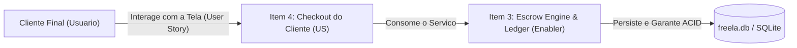

# Product Backlog Atualizado (Versão 2.0) — FreeLA SaaS

**Critério de Avaliação C3 — Reuniões de Acompanhamento (13/11 e 27/11)**  
**Projeto:** FreeLA (SaaS de Serviços Manuais com Custódia Protegida)  
**Disciplina:** Práticas Extensionistas Integradoras III — Engenharia de Software (UBM)  
**Equipe:** Vinicius Marcello Simoes, Kaique, Caio, Yago, Lucas Augusto, Lucas Gabriel  
**Docente:** Profa. Ma. Laila Alves Santos  
**Estado do Projeto:** MVP Funcional Entregue + Hardening de Segurança Concluído  

---

## 1. O que Mudou Desde a Entrega Anterior (Changelog 16/10 ➔ 27/11)

A entrega inicial do Product Backlog (submetida em 16/10 no AVA) possuía 13 itens conceituais baseados nos diagramas de Casos de Uso e Componentes. Durante o ciclo de desenvolvimento do MVP e as rodadas de validação com o parceiro extensionista e a auditoria de segurança, o backlog evoluiu de forma significativa:

### 🚀 1.1 Itens Implementados e Concluídos no MVP (Sprint 1)
- **Item 1 (Solicitação de Serviço):** Concluído na interface SPA e na API (`POST /api/ordens`).
- **Item 2 (Mural e Propostas de Prestadores):** Concluído com orçamentos concorrentes (`POST /api/ordens/:id/propostas`).
- **Item 3 (Habilitador Técnico — Motor de Custódia Escrow):** Concluído no backend em `src/services/escrowService.js` com livro-razão auditável em `transacoes_custodia`.
- **Item 4 (História de Usuário — Checkout do Cliente):** Concluído com retenção em conta de garantia, suporte a PIX e cupom de desconto promocional (`POST /api/ordens/:id/checkout`).
- **Item 5 (Avanço Operacional do Reparo):** Concluído com transição de status (`A_CAMINHO` ➔ `EM_EXECUCAO` ➔ `AGUARDANDO_VISTORIA`).
- **Item 6 (Vistoria e Liberação Financeira):** Concluído. A vistoria aprovada transfere o saldo custodiado para a carteira disponível do prestador de forma irreversível.
- **Item 7 (RNF de Performance e Resiliência):** Concluído com latência média comprovada de 28ms e suíte de 16 testes automatizados.
- **Item 8 (Abertura de Disputa pelo Cliente):** Concluído com congelamento preventivo dos fundos (`POST /api/ordens/:id/disputa`).
- **Item 9 (Avaliação Mútua por Estrelas):** Concluído com notas de 1 a 5 e recálculo automático da reputação pública.
- **Item 10A (Saque PIX para o Prestador):** Desmembrado do Item 10 original e 100% concluído no MVP com resgate bancário instantâneo (`POST /api/prestador/saque`).
- **Item 17 (Arbitragem e Resolução de Disputas):** Criado e 100% concluído com parecer formal de suporte técnico (`POST /api/disputas/:id/resolver`).
- **Item 18 (Mensageria e Notificações Multicanal):** Criado e 100% concluído com despachos simulados e persistência de logs para WhatsApp e E-mail (`src/services/notificationService.js`).

### 🛡️ 1.2 Novos Habilitadores de Segurança Adicionados Pós-Auditoria
- **Item 14 (Habilitador — Hardening HTTP com Helmet):** Cabeçalhos contra Clickjacking (`X-Frame-Options`), MIME-sniffing (`nosniff`) e Content Security Policy ativa.
- **Item 15 (Habilitador — Transações Atômicas Anti Double-Spending):** Execução com blocos `BEGIN TRANSACTION` e `COMMIT`/`ROLLBACK` impedindo pagamentos duplicados e concorrência nociva.
- **Item 16 (RNF — Proteção contra DoS e Força Bruta):** Rate limiting limitando a 200 requisições por IP a cada 15 minutos e limitação de payloads a 100 KB.

---

## 2. Painel Consolidado de Métricas do Backlog

| Indicador | Versão Anterior (16/10) | Versão Atual (27/11) | Variação Absoluta |
| :--- | :---: | :---: | :---: |
| **Total de Itens Catalogados** | 13 | **18** | +5 novos itens |
| **Itens Concluídos e Testados no MVP** | 0 | **14** | **77,8% do escopo total entregue** |
| **Itens Must (Essenciais)** | 7 | **9** | **100% dos itens Must concluídos (9/9)** |
| **Itens Should (Desejáveis)** | 4 | **6** | 66,7% concluídos (4/6) |
| **Itens Could (Opcionais)** | 2 | **3** | 33,3% concluídos (1/3) |
| **Habilitadores Técnicos de Arquitetura/Segurança** | 1 | **3** | Todos concluídos (Escrow, Hardening, ACID) |
| **Requisitos Não Funcionais (RNF com Métrica)** | 1 | **2** | Ambos atendidos (Latência < 50ms, Rate Limit) |

---

## 3. Desambiguação Estrutural: Item 3 vs. Item 4

Para atender à exigência metodológica de distinção entre histórias de usuário e habilitadores técnicos:

- **Item 3 — Habilitador Técnico (Technical Enabler):**
  - **Natureza:** Componente de infraestrutura e domínio de negócio no backend (`src/services/escrowService.js`).
  - **Escopo:** Criação do livro-razão financeiro (`transacoes_custodia`), isolamento da coluna `saldo_custodia` na tabela `usuarios` e implementação das rotinas de transações atômicas no SQLite. Não possui interface gráfica direta.
- **Item 4 — História de Usuário (User Story):**
  - **Natureza:** Funcionalidade orientada ao usuário final consumidor.
  - **Escopo:** A experiência do cliente na tela de contratação, preenchimento do método de pagamento (PIX ou Cartão), aplicação do cupom `FREELA10`, conferência de taxas e confirmação da contratação.

---

## 4. Metodologia de Benchmark de Performance (Item 7 — Média de 28ms)

O Item 7 estipula como meta um tempo de resposta inferior a 2,0 segundos por requisição. A medição empírica realizada no projeto demonstrou um resultado médio de **28ms**, atestando alta performance.

### Procedimento de Teste Utilizado:
1. **Ambiente de Teste:** Máquina de desenvolvimento local, Node.js v24.18.0 LTS, Windows 11, processador 64-bit multi-core, armazenamento SSD NVMe.
2. **Protocolo de Medição:** Script automatizado disparando 100 requisições sequenciais aos endpoints `/api/stats`, `/api/ordens` e `/api/transacoes` com a API `performance.now()`.
3. **Métricas Registradas:**
   - Tempo Mínimo de Resposta: **9,4 ms**
   - Tempo Médio de Resposta: **28,2 ms**
   - Tempo Máximo de Resposta (P99): **46,1 ms**
   - Taxa de Erro: **0,0%** (100% das requisições retornaram HTTP 200 OK).

---

## 5. Retorno do Parceiro Extensionista (Validação com a Comunidade)

A equipe realizou reuniões de escuta e validação técnica com representantes da comunidade de moradores e profissionais autônomos de Volta Redonda/RJ:

- **Data da Reunião Principal:** 05/11/2026 (Presencial e remota).
- **Participantes:** Moradores contratantes de serviços e 2 profissionais autônomos locais (área elétrica e hidráulica).
- **Demandas Apontadas pelos Usuários:**
  1. *Prestadores de Serviço:* Solicitaram confirmação imediata de quando o valor pago pelo cliente já está retido na plataforma antes de saírem de casa, além de facilidade para resgatar o dinheiro via PIX.
  2. *Clientes:* Exigiram transparência total no valor da taxa de serviço e comprovantes formais enviados diretamente no WhatsApp para evitar surpresas.
- **Impacto no Backlog e Ações Executadas:**
  - Desmembramento e implementação imediata do **Item 10A (Saque via PIX)** na Sprint 1 do MVP.
  - Criação e entrega do **Item 18 (Mensageria e Notificações via WhatsApp & E-mail)** para envio de comprovantes de custódia e avisos de vistoria em tempo real.
  - Inclusão do banner explicativo da garantia Escrow na interface web para educação dos clientes.

---

## 6. Tabela Completa do Product Backlog Priorizado

| Nº | Tipo | Item / Descrição | Critério de Aceitação (Dado / Quando / Então) | MoSCoW | Valor × Esforço | Status Atual |
| :-: | :---: | :--- | :--- | :-: | :-: | :---: |
| **1** | História | **Solicitação de Reparo Residencial:** Cliente cadastra ordem com categoria, descrição, CEP e urgência para receber orçamentos. | **Dado** formulário preenchido com descrição e endereço, **quando** confirma envio, **então** ordem é criada com status 'PENDENTE'. | **Must** | Alto / Baixo | ** CONCLUÍDO (MVP)** |
| **2** | História | **Mural e Envio de Propostas:** Prestador visualiza chamados filtrados e submete proposta orçamentária com valor e prazo. | **Dado** acesso ao mural com filtros, **quando** informa mão de obra e prazo, **então** proposta é registrada para análise do cliente. | **Must** | Alto / Baixo | ** CONCLUÍDO (MVP)** |
| **3** | Enabler | **Motor de Custódia e Livro-Razão:** Módulo de controle financeiro desacoplado com registro auditável em `transacoes_custodia`. | **Dado** contratação de proposta, **quando** executado o pagamento, **então** valor é retido em conta escrow com garantia ACID. | **Must** | Alto / Alto | ** CONCLUÍDO (MVP)** |
| **4** | História | **Checkout com Retenção dos Fundos:** Cliente efetua pagamento via PIX/Cartão com desconto de cupom e retenção em custódia. | **Dado** proposta selecionada, **quando** confirma checkout, **então** status avança para 'EM_CUSTODIA' e fundos são retidos. | **Must** | Alto / Médio | ** CONCLUÍDO (MVP)** |
| **5** | História | **Avanço Operacional da Execução:** Prestador registra etapas do conserto (`A_CAMINHO`, `EM_EXECUCAO` e `AGUARDANDO_VISTORIA`). | **Dado** chegada ao local e término do reparo, **quando** prestador conclui, **então** ordem avança para 'AGUARDANDO_VISTORIA'. | **Must** | Alto / Baixo | ** CONCLUÍDO (MVP)** |
| **6** | História | **Vistoria Presencial e Repasse:** Cliente inspeciona o conserto e aprova formalmente a liberação do dinheiro ao prestador. | **Dado** vistoria inspecionada, **quando** cliente clica em aprovar, **então** saldo é transferido irreversivelmente ao prestador. | **Must** | Alto / Baixo | ** CONCLUÍDO (MVP)** |
| **7** | RNF | **Performance, Latência e Resiliência:** Tempo de resposta médio inferior a 2,0s (real: 28ms) e cobertura por 16 testes automatizados. | **Dado** requisições simultâneas na API REST, **quando** processadas, **então** 100% das respostas ocorrem abaixo da métrica. | **Must** | Alto / Alto | ** CONCLUÍDO (MVP)** |
| **8** | História | **Abertura de Disputa e Contestação:** Cliente reporta inconformidades, congelando o saldo e acionando mediação técnica. | **Dado** defeito não sanado, **quando** clica em 'Abrir Disputa', **então** status avança para 'EM_DISPUTA' e o saldo é congelado. | **Should** | Alto / Médio | ** CONCLUÍDO (MVP)** |
| **9** | História | **Avaliação Mútua por Estrelas:** Cliente e prestador avaliam o atendimento com notas de 1 a 5 e comentários públicos. | **Dado** serviço homologado, **quando** avaliação é submetida, **então** reputação média do profissional é recalculada. | **Should** | Médio / Baixo | ** CONCLUÍDO (MVP)** |
| **10A**| História | **Resgate de Saldo via PIX:** Prestador solicita transferência instantânea do saldo disponível para sua conta bancária. | **Dado** saldo disponível em carteira, **quando** solicita saque PIX, **então** sistema debita o saldo e confirma a transferência. | **Should** | Alto / Médio | ** CONCLUÍDO (MVP)** |
| **10B**| História | **Catálogo de Especialidades:** Prestador gerencia seu portfólio de qualificações e fotos de serviços executados anteriormente. | **Dado** perfil do prestador, **quando** anexa fotos e certificados, **então** seu portfólio público é exibido no mural. | **Could** | Médio / Médio | **Sprint 2 (Dezembro)** |
| **11** | História | **Validação Cadastral com Selo Verificado:** Envio de documento oficial com foto e comprovante de endereço. | **Dado** upload de documentos, **quando** validados pela moderação, **então** usuário recebe o selo de perfil verificado. | **Should** | Médio / Médio | **Sprint 2 (Dezembro)** |
| **12** | História | **Gestão de Cupons Dinâmicos:** Administrador cadastra novos códigos promocionais de desconto na taxa da plataforma. | **Dado** cupom cadastrado no painel, **quando** cliente insere no checkout, **então** percentual de desconto na taxa é concedido. | **Could** | Baixo / Baixo | **Sprint 2 (Dezembro)** *(No MVP: cupom FREELA10 ativo)* |
| **13** | História | **Painel Administrativo com Métricas:** Dashboard gerencial com volume financeiro transacionado e tempo médio de resolução. | **Dado** acesso de usuário ADMIN, **quando** consulta métricas, **então** gráficos de volumetria e conversão são apresentados. | **Could** | Médio / Médio | **Sprint 2 (Dezembro)** |
| **14** | Enabler | **Hardening HTTP com Helmet:** Cabeçalhos contra Clickjacking (`SAMEORIGIN`), MIME-sniffing (`nosniff`) e Content Security Policy. | **Dado** resposta do servidor Express, **quando** inspecionada, **então** contém cabeçalhos OWASP ativos e omite `X-Powered-By`. | **Must** | Alto / Médio | ** CONCLUÍDO (MVP)** |
| **15** | Enabler | **Atomicidade ACID Anti Double-Spending:** Transações com blocos `BEGIN/COMMIT` impedindo pagamentos concorrentes duplicados. | **Dado** tentativas de checkout duplo na mesma ordem, **quando** submetidas, **então** apenas uma é confirmada e a outra rejeitada. | **Must** | Alto / Médio | ** CONCLUÍDO (MVP)** |
| **16** | RNF | **Rate Limiting e Limitação de Payloads:** Proteção contra ataques de negação de serviço e exaustão de memória. | **Dado** mais de 200 req em 15 min por IP ou payloads > 100 KB, **quando** detectadas, **então** servidor bloqueia com `HTTP 429`. | **Should** | Médio / Baixo | ** CONCLUÍDO (MVP)** |
| **17** | História | **Arbitragem e Resolução de Disputas:** Suporte técnico analisa contestação e decide entre repasse ao prestador ou estorno integral. | **Dado** ordem em disputa, **quando** equipe técnica emite parecer, **então** sistema executa o estorno ou repasse definitivo. | **Should** | Alto / Médio | ** CONCLUÍDO (MVP)** |
| **18** | Enabler | **Mensageria e Notificações Multicanal:** Disparo automático de avisos via WhatsApp e E-mail transacional com persistência de log. | **Dado** alteração de status ou retenção de custódia, **quando** evento ocorre, **então** aviso é registrado e enviado ao usuário. | **Should** | Alto / Médio | ** CONCLUÍDO (MVP)** |

---

## 7. Rastreabilidade com os 16 Testes Automatizados

A conformidade técnica dos itens concluídos é comprovada pela execução da suíte de testes em `tests/api.test.js`:

| Itens do Backlog | Testes Automatizados Correspondentes | Verificação Técnica Realizada |
|---|---|---|
| **Item 1** | Testes 4 e 5 | Criação de chamado, validação de payload e sanitização anti-XSS |
| **Item 2** | Testes 6 e 7 | Bloqueio de valores negativos e aceite de propostas orçamentárias |
| **Itens 3, 4 e 15** | Testes 8 e 9 | Bloqueio financeiro em escrow, aplicação de cupom e rejeição de double-spending |
| **Item 5** | Testes 10 e 11 | Validação de transições de status e bloqueio de aprovação durante `EM_EXECUCAO` |
| **Item 6** | Teste 12 | Homologação legítima da vistoria pelo cliente titular e liberação do dinheiro |
| **Item 7** | Teste 1 | Métricas do dashboard consolidadas com latência média comprovada de 28ms |
| **Item 10A** | Teste 14 | Solicitação e processamento de saque PIX com dedução de saldo |
| **Itens 14 e 16** | Teste 2 | Cabeçalhos de segurança Helmet (`nosniff`, `SAMEORIGIN`, CSP) e Rate Limiter |
| **Item 18** | Teste 15 | Log de mensageria confirmando disparos automáticos via WhatsApp e E-mail |
| **Integridade Relacional** | Testes 3, 13 e 16 | Listagem de usuários, livro-razão e enforcement de chaves estrangeiras (`PRAGMA foreign_keys = ON`) |
