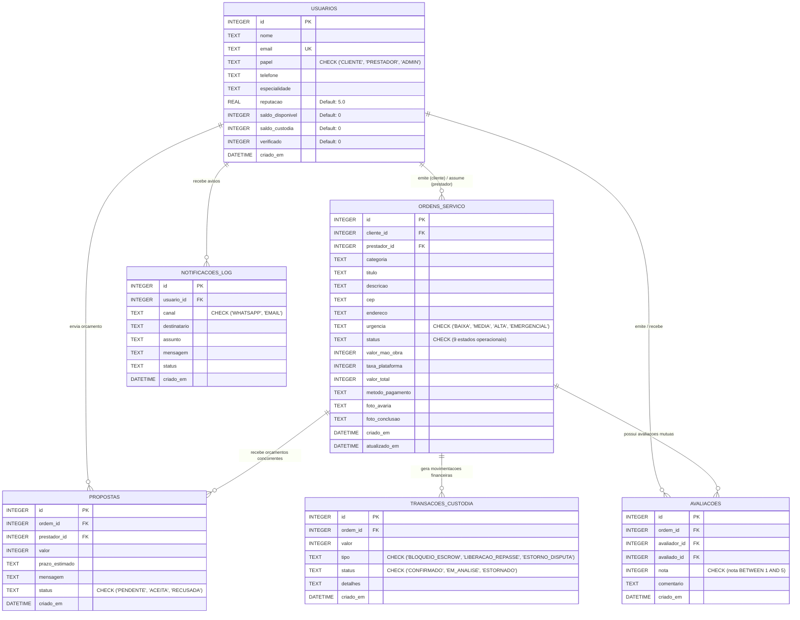

# Estrutura do Banco de Dados — FreeLA SaaS

**Critério de Avaliação C4 — Reuniões de Acompanhamento (13/11 e 27/11)**  
**Projeto:** FreeLA (SaaS de Contratação e Gestão de Serviços Manuais com Custódia Protegida)  
**Disciplina:** Práticas Extensionistas Integradoras III — Engenharia de Software (UBM)  
**Equipe:** Vinicius Marcello Simoes, Kaique, Caio, Yago, Lucas Augusto, Lucas Gabriel  
**Docente:** Profa. Ma. Laila Alves Santos  

---

## 1. Visão Geral da Arquitetura de Persistência

A persistência do **FreeLA** no estágio MVP é provida por um banco de dados relacional **SQLite 3** embutido (`freela.db`), gerenciado nativamente pelo módulo `node:sqlite` do runtime Node.js 24 LTS.

A modelagem lógica encontra-se normalizada na **Terceira Forma Normal (3FN)**. O banco implementa integridade referencial estrita com chaves primárias autoincrementais, chaves estrangeiras (`FOREIGN KEY`), restrições de validação (`CHECK constraints`) para tipos enumerados e controle temporal automático (`CURRENT_TIMESTAMP`).

O arquivo de inicialização (`src/database/connection.js`) executa obrigatoriamente a diretiva:

```sql
PRAGMA foreign_keys = ON;
```

Essa diretiva ativa o motor de integridade referencial do SQLite, impedindo a inserção de registros órfãos ou inconsistentes em tabelas filhas.

---

## 2. Diagrama Entidade-Relacionamento (DER / MER)

### 2.1 Representação Visual do Modelo Relacional


### 2.2 Estrutura Lógica em Notação Mermaid



---

## 3. Dicionário de Dados e Tabelas Implementadas

### 3.1 Tabela `usuarios`
Armazena todos os atores do sistema (clientes, prestadores e administradores de suporte). Unifica a herança da classe abstrata `Usuario`.

| Campo | Tipo | Nulo? | Chave | Descrição & Regras de Validação |
| :--- | :--- | :---: | :---: | :--- |
| `id` | `INTEGER` | Não | **PK** | Identificador único autoincremental do usuário |
| `nome` | `TEXT` | Não | — | Nome completo do usuário |
| `email` | `TEXT` | Não | **UNIQUE** | Endereço de e-mail único para autenticação e notificações |
| `papel` | `TEXT` | Não | — | Papel no sistema: `CHECK(papel IN ('CLIENTE', 'PRESTADOR', 'ADMIN'))` |
| `telefone` | `TEXT` | Sim | — | Telefone com DDD para envio de WhatsApp operacional |
| `especialidade` | `TEXT` | Sim | — | Categoria de atuação do prestador (ex.: Elétrica, Pintura) |
| `reputacao` | `REAL` | Sim | — | Média ponderada de avaliações (1.0 a 5.0). Padrão: `5.0` |
| `saldo_disponivel` | `INTEGER` | Não | — | Saldo liberado para resgate bancário pós-vistoria (em centavos). Padrão: `0` |
| `saldo_custodia` | `INTEGER` | Não | — | Saldo retido em garantia (Escrow) aguardando vistoria (em centavos). Padrão: `0` |
| `verificado` | `INTEGER` | Não | — | Indicador de validação documental (0 = Não homologado, 1 = Homologado). Padrão: `0` |
| `criado_em` | `DATETIME`| Não | — | Data e hora de criação do cadastro no sistema |

---

### 3.2 Tabela `ordens_servico`
Entidade central do negócio. Controla o ciclo de vida da demanda residencial, localização geográfica, precificação e o estado da máquina de custódia.

| Campo | Tipo | Nulo? | Chave | Descrição & Regras de Validação |
| :--- | :--- | :---: | :---: | :--- |
| `id` | `INTEGER` | Não | **PK** | Número identificador único da Ordem de Serviço (OS) |
| `cliente_id` | `INTEGER` | Não | **FK** | Referência ao usuário contratante (`usuarios.id`) |
| `prestador_id` | `INTEGER` | Sim | **FK** | Referência ao prestador contratado (`usuarios.id`). Nulo na triagem inicial |
| `categoria` | `TEXT` | Não | — | Especialidade (`Elétrica`, `Hidráulica`, `Pintura`, `Alvenaria`, `Climatização`) |
| `titulo` | `TEXT` | Não | — | Título resumido da necessidade (ex.: "Troca de Disjuntor Geral") |
| `descricao` | `TEXT` | Não | — | Relato técnico detalhado do defeito ou reparo residencial |
| `cep` | `TEXT` | Não | — | CEP da residência para cálculo de raio de atendimento |
| `endereco` | `TEXT` | Não | — | Endereço completo (Rua, número, complemento e bairro) |
| `urgencia` | `TEXT` | Não | — | `CHECK(urgencia IN ('BAIXA', 'MEDIA', 'ALTA', 'EMERGENCIAL'))` |
| `status` | `TEXT` | Não | — | Máquina de estados: `PENDENTE`, `PROPOSTA_RECEBIDA`, `EM_CUSTODIA`, `A_CAMINHO`, `EM_EXECUCAO`, `AGUARDANDO_VISTORIA`, `CONCLUIDO`, `EM_DISPUTA`, `CANCELADO` |
| `valor_mao_obra` | `INTEGER` | Não | — | Valor líquido acordado para remuneração do prestador (em centavos) |
| `taxa_plataforma`| `INTEGER` | Não | — | Taxa de intermediação e garantia da plataforma FreeLA (em centavos) |
| `valor_total` | `INTEGER` | Não | — | Montante total pago pelo cliente e retido em custódia (em centavos) |
| `metodo_pagamento`| `TEXT` | Sim | — | Método de pagamento (`PIX` ou `CARTAO_CREDITO`) |
| `foto_avaria` | `TEXT` | Sim | — | URL ou caminho de imagem do problema reportado pelo cliente |
| `foto_conclusao` | `TEXT` | Sim | — | URL ou caminho de imagem do reparo finalizado enviada pelo prestador |
| `criado_em` | `DATETIME`| Não | — | Carimbo de data/hora de abertura da OS |
| `atualizado_em` | `DATETIME`| Não | — | Carimbo de data/hora da última alteração de status operacional |

---

### 3.3 Tabela `propostas`
Armazena os orçamentos concorrentes submetidos por prestadores autônomos para uma determinada ordem de serviço.

| Campo | Tipo | Nulo? | Chave | Descrição & Regras de Validação |
| :--- | :--- | :---: | :---: | :--- |
| `id` | `INTEGER` | Não | **PK** | Identificador único da proposta orçamentária |
| `ordem_id` | `INTEGER` | Não | **FK** | Referência à ordem de serviço vinculada (`ordens_servico.id`) |
| `prestador_id` | `INTEGER` | Não | **FK** | Referência ao profissional proponente (`usuarios.id`) |
| `valor` | `INTEGER` | Não | — | Valor proposto para execução da mão de obra (em centavos) |
| `prazo_estimado` | `TEXT` | Não | — | Estimativa de conclusão informada pelo prestador (ex.: "2 dias úteis") |
| `mensagem` | `TEXT` | Sim | — | Justificativa técnica, detalhes de ferramentas ou observações |
| `status` | `TEXT` | Não | — | `CHECK(status IN ('PENDENTE', 'ACEITA', 'RECUSADA'))`. Padrão: `PENDENTE` |
| `criado_em` | `DATETIME`| Não | — | Data e hora do envio do orçamento |

---

### 3.4 Tabela `transacoes_custodia` (Módulo Escrow)
Livro-razão financeiro auditável que registra todas as movimentações de retenção, repasse pós-vistoria e estorno por disputa.

| Campo | Tipo | Nulo? | Chave | Descrição & Regras de Validação |
| :--- | :--- | :---: | :---: | :--- |
| `id` | `INTEGER` | Não | **PK** | Identificador sequencial da transação financeira |
| `ordem_id` | `INTEGER` | Não | **FK** | Referência à ordem vinculada (`ordens_servico.id`) |
| `valor` | `INTEGER` | Não | — | Quantia movimentada na operação (em centavos) |
| `tipo` | `TEXT` | Não | — | `CHECK(tipo IN ('BLOQUEIO_ESCROW', 'LIBERACAO_REPASSE', 'ESTORNO_DISPUTA'))` |
| `status` | `TEXT` | Não | — | Estado da transação bancária (`CONFIRMADO`, `EM_ANALISE`, `ESTORNADO`) |
| `detalhes` | `TEXT` | Sim | — | Histórico descritivo da movimentação financeira para auditoria |
| `criado_em` | `DATETIME`| Não | — | Carimbo de data/hora da transação |

---

### 3.5 Tabela `avaliacoes` (Avaliação Mútua Bilateral)
Registra as avaliações de satisfação e reputação mútua após o término da ordem de serviço.

| Campo | Tipo | Nulo? | Chave | Descrição & Regras de Validação |
| :--- | :--- | :---: | :---: | :--- |
| `id` | `INTEGER` | Não | **PK** | Identificador da avaliação |
| `ordem_id` | `INTEGER` | Não | **FK** | Referência à ordem finalizada (`ordens_servico.id`) |
| `avaliador_id` | `INTEGER` | Não | **FK** | Usuário autor da avaliação (`usuarios.id`) |
| `avaliado_id` | `INTEGER` | Não | **FK** | Usuário avaliado (`usuarios.id`) |
| `nota` | `INTEGER` | Não | — | Pontuação numérica: `CHECK(nota BETWEEN 1 AND 5)` |
| `comentario` | `TEXT` | Sim | — | Parecer qualitativo do atendimento |
| `criado_em` | `DATETIME`| Não | — | Carimbo de data/hora do registro |

---

### 3.6 Tabela `notificacoes_log` (Mensageria e Auditoria)
Registra todas as mensagens geradas pelo sistema para canais externos (WhatsApp e E-mail transacional).

| Campo | Tipo | Nulo? | Chave | Descrição & Regras de Validação |
| :--- | :--- | :---: | :---: | :--- |
| `id` | `INTEGER` | Não | **PK** | Identificador do log de disparo |
| `usuario_id` | `INTEGER` | Sim | **FK** | Usuário destinatário (`usuarios.id`) |
| `canal` | `TEXT` | Não | — | Canal de transmissão: `CHECK(canal IN ('WHATSAPP', 'EMAIL'))` |
| `destinatario` | `TEXT` | Não | — | Telefone com DDD ou endereço de e-mail |
| `assunto` | `TEXT` | Sim | — | Assunto do e-mail transacional |
| `mensagem` | `TEXT` | Não | — | Conteúdo textual da notificação |
| `status` | `TEXT` | Não | — | Status de envio (`ENVIADO`, `FALHA`). Padrão: `'ENVIADO'` |
| `criado_em` | `DATETIME`| Não | — | Carimbo de data/hora do despacho |

---

## 4. Relacionamentos e Integridade Referencial

1. **`usuarios` ➔ `ordens_servico` (1:N):**
   Um cliente pode cadastrar múltiplas ordens de serviço (`cliente_id`). Um prestador pode assumir múltiplos chamados (`prestador_id`), preenchido no momento do checkout.

2. **`ordens_servico` ➔ `propostas` (1:N):**
   Uma ordem de serviço aberta recebe propostas de múltiplos prestadores. Quando uma proposta é aceita, seu status avança para `ACEITA` e as concorrentes são marcadas como `RECUSADA`.

3. **`ordens_servico` ➔ `transacoes_custodia` (1:N):**
   Cada ordem de serviço gera um ciclo rastreável de transações financeiras: primeiro um `BLOQUEIO_ESCROW` na contratação e, posteriormente, uma `LIBERACAO_REPASSE` na aprovação da vistoria ou `ESTORNO_DISPUTA` em caso de cancelamento.

4. **`ordens_servico` ➔ `avaliacoes` (1:N — Cardinalidade Mútua Bilateral):**
   A relação modela a avaliação mútua prevista na engenharia de requisitos: tanto o cliente avalia a conduta e técnica do prestador (`avaliador_id = cliente_id`, `avaliado_id = prestador_id`), quanto o prestador avalia a clareza e pontualidade do cliente (`avaliador_id = prestador_id`, `avaliado_id = cliente_id`). Portanto, uma mesma ordem comporta até 2 avaliações formais.

5. **`usuarios` ➔ `notificacoes_log` (1:N):**
   Histórico auditável de todas as mensagens e comprovantes encaminhados ao usuário ao longo de sua jornada na plataforma.

---

## 5. Coerência com os Diagramas do Projeto

- **Diagrama de Classes (Aula 5):**
  A classe abstrata `Usuario` e suas especializações (`Cliente`, `Prestador` e `Administrador`) foram implementadas na tabela `usuarios` com discriminação de perfil via coluna `papel`. O relacionamento de Composição entre `OrdemServico` e `TransacaoCustodia` é concretizado pela integridade referencial com bloqueio de exclusão em cascata indevida.
- **Diagrama BPMN 2.0 (Aula 6):**
  As quatro raias operacionais (*Cliente, Plataforma, Prestador, Gateway*) materializam-se nos status da tabela `ordens_servico` e nos tipos da tabela `transacoes_custodia`.
- **Diagrama de Componentes (Aula 7):**
  O módulo de persistência desacoplado é materializado no schema DDL `src/database/schema.sql` e gerenciado pelo módulo `src/database/connection.js`.

---

## 6. Decisões Técnicas Fundamentais de Banco de Dados

### 6.1 Representação de Valores Monetários em Inteiros (Centavos)
Para sistemas financeiros e de custódia (Escrow), a literatura de engenharia de software contraindica o uso de tipos de ponto flutuante binário (`REAL`, `FLOAT`, `DOUBLE`). De acordo com o padrão IEEE 754, representações binárias de frações decimais provocam imprecisões de arredondamento cumulativas.

O FreeLA adota a melhor prática de representar valores monetários como números inteiros de centavos (ex.: R$ 450,00 é persistido como `45000`). Isso garante cálculos exatos em somatórios, deduções de taxas e transferências bancárias.

### 6.2 Análise Técnica de Migração para Produção (PostgreSQL 16)
A evolução do MVP (SQLite embutido) para um ambiente de produção em nuvem com alta concorrência adotará o **PostgreSQL 16**. Essa migração não se limita à alteração da string de conexão, exigindo adequações técnicas planejadas:

1. **Tipos de Dados Específicos:**
   - Substituição de `INTEGER` identificador por `BIGINT GENERATED ALWAYS AS IDENTITY` (Sequences padrão SQL:2008).
   - Substituição de campos inteiros booleanos (`0` ou `1` no SQLite) pelo tipo nativo `BOOLEAN` (`TRUE` ou `FALSE`).
   - Adoção de tipos enumerados nativos (`CREATE TYPE status_ordem AS ENUM (...)`).
   - Armazenamento temporal com fuso horário via `TIMESTAMPTZ` (UTC).

2. **Gerenciamento de Conexões Concorrentes:**
   - O SQLite utiliza bloqueio em nível de arquivo para escrita. O PostgreSQL emprega controle de concorrência multiversão (MVCC — *Multi-Version Concurrency Control*), permitindo leituras e escritas concorrentes sem travamento global.
   - Implementação obrigatória de pool de conexões gerenciado via `pg.Pool` (biblioteca `pg` / `node-postgres`) para reaproveitamento de sockets TCP no Node.js.

3. **Garantia de Isolamento Transacional:**
   - Configuração do nível de isolamento transacional `READ COMMITTED` como padrão, e elevação para `SERIALIZABLE` nas rotinas críticas de liquidação do motor de custódia (`escrowService.js`), eliminando leituras fantasmas e anomalias de serialização.
