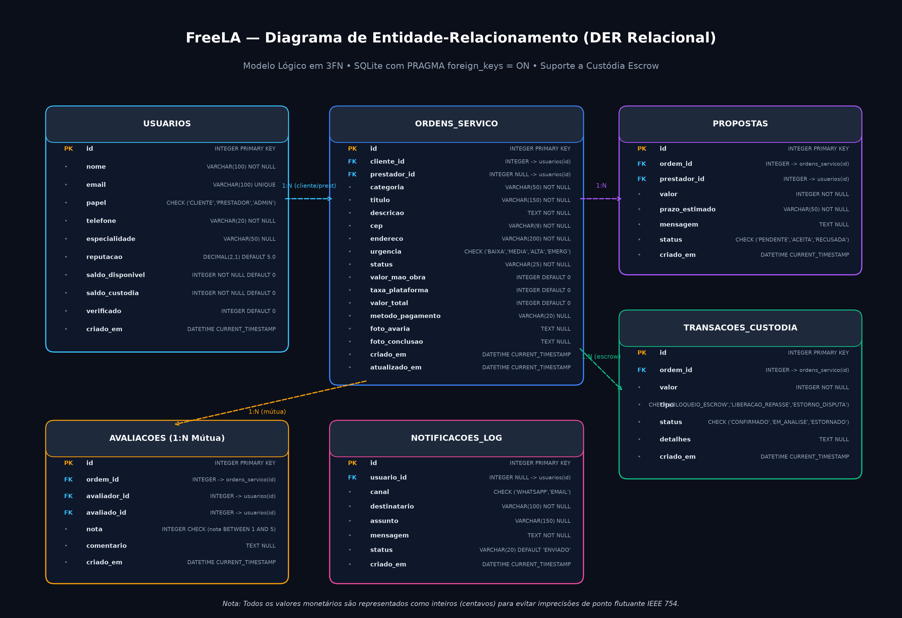
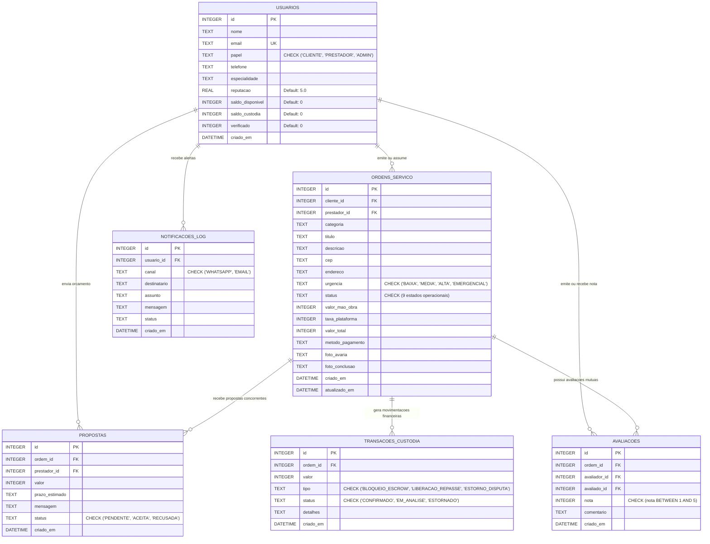

# CENTRO UNIVERSITÁRIO DE BARRA MANSA (UBM)
## CURSO DE ENGENHARIA DE SOFTWARE
### PRÁTICAS EXTENSIONISTAS INTEGRADORAS III

**PROJETO FREELA: PLATAFORMA SAAS DE SERVIÇOS COM CUSTÓDIA FINANCEIRA (ESCROW)**  
**DOCUMENTO DE ENGENHARIA DE DADOS: ESTRUTURA DO BANCO DE DADOS E MODELO RELACIONAL**

* **Equipe de Desenvolvimento:** Vinicius Marcello Simões, Kaique, Caio, Yago, Lucas Augusto, Lucas Gabriel
* **Orientação Docente:** Profa. Ma. Laila Alves Santos
* **Data da Versão:** 24 de novembro de 2026
* **Critério de Avaliação Atendido:** C4 (Reuniões de Acompanhamento de 13/11 e 27/11)

---

## 1 INTRODUÇÃO E MODELO DE PERSISTÊNCIA RELACIONAL

A persistência de dados do FreeLA no estágio MVP utiliza o mecanismo relacional **SQLite 3** embutido no arquivo local `freela.db`. O runtime Node.js gerencia as conexões através da biblioteca nativa `node:sqlite`.

A modelagem lógica encontra-se normalizada na **Terceira Forma Normal (3FN)**. O banco de dados implementa integridade referencial com chaves primárias autoincrementais, chaves estrangeiras com restrição de chave (`FOREIGN KEY`), checagem de tipos enumerados (`CHECK constraints`) e carimbos temporais automáticos (`CURRENT_TIMESTAMP`).

O arquivo de inicialização (`src/database/connection.js`) executa obrigatoriamente a instrução:

```sql
PRAGMA foreign_keys = ON;
```

Essa diretiva habilita a verificação ativa de chaves estrangeiras no motor SQLite, bloqueando a gravação de registros órfãos nas tabelas filhas.

---

## 2 DIAGRAMA ENTIDADE-RELACIONAMENTO (DER)

### 2.1 Representação Gráfica do Modelo Lógico

A Figura 1 apresenta o Diagrama Entidade-Relacionamento do banco de dados relacional implementado.



Figura 1: Diagrama Entidade-Relacionamento lógico do FreeLA em 3FN.  
Fonte: Autores (2026).

---

### 2.2 Estrutura Relacional em Notação Mermaid

A Figura 2 ilustra as entidades, atributos principais e relacionamentos na notação Entity-Relationship.



Figura 2: Diagrama de Entidade-Relacionamento estruturado em Mermaid.  
Fonte: Autores (2026).

---

## 3 DICIONÁRIO DE DADOS E ESPECIFICAÇÃO DE TABELAS

### 3.1 Tabela `usuarios`
Centraliza o cadastro dos atores do sistema. A Tabela 1 documenta os campos da entidade.

Tabela 1: Dicionário de dados da tabela `usuarios`.

| Coluna | Tipo de Dado | Nulo? | Chave | Regras de Validação e Descrição |
|---|---|:---:|:---:|---|
| `id` | `INTEGER` | Não | PK | Identificador sequencial primário autoincremental |
| `nome` | `TEXT` | Não | — | Nome completo do usuário |
| `email` | `TEXT` | Não | UNIQUE | Endereço eletrônico único para autenticação |
| `papel` | `TEXT` | Não | — | `CHECK(papel IN ('CLIENTE', 'PRESTADOR', 'ADMIN'))` |
| `telefone` | `TEXT` | Sim | — | Telefone com DDD para notificações via WhatsApp |
| `especialidade` | `TEXT` | Sim | — | Especialidade profissional do prestador |
| `reputacao` | `REAL` | Sim | — | Média ponderada de avaliações. Padrão: `5.0` |
| `saldo_disponivel` | `INTEGER` | Não | — | Saldo liberado para resgate (em centavos). Padrão: `0` |
| `saldo_custodia` | `INTEGER` | Não | — | Saldo bloqueado em garantia (em centavos). Padrão: `0` |
| `verificado` | `INTEGER` | Não | — | Homologação documental (0: Não, 1: Sim). Padrão: `0` |
| `criado_em` | `DATETIME` | Não | — | Data e hora de criação do registro |

Fonte: Autores (2026).

---

### 3.2 Tabela `ordens_servico`
Entidade central do fluxo operacional. A Tabela 2 apresenta as especificações dos atributos da ordem de serviço.

Tabela 2: Dicionário de dados da tabela `ordens_servico`.

| Coluna | Tipo de Dado | Nulo? | Chave | Regras de Validação e Descrição |
|---|---|:---:|:---:|---|
| `id` | `INTEGER` | Não | PK | Identificador único da Ordem de Serviço |
| `cliente_id` | `INTEGER` | Não | FK | Referência ao contratante (`usuarios.id`) |
| `prestador_id` | `INTEGER` | Sim | FK | Referência ao profissional contratado (`usuarios.id`) |
| `categoria` | `TEXT` | Não | — | Especialidade da mão de obra solicitada |
| `titulo` | `TEXT` | Não | — | Título descritivo resumido do reparo |
| `descricao` | `TEXT` | Não | — | Descrição detalhada do defeito apresentado |
| `cep` | `TEXT` | Não | — | Código de Endereçamento Postal da residência |
| `endereco` | `TEXT` | Não | — | Logradouro, número, complemento e bairro |
| `urgencia` | `TEXT` | Não | — | `CHECK(urgencia IN ('BAIXA', 'MEDIA', 'ALTA', 'EMERGENCIAL'))` |
| `status` | `TEXT` | Não | — | `CHECK(status IN ('PENDENTE', 'PROPOSTA_RECEBIDA', 'EM_CUSTODIA', 'A_CAMINHO', 'EM_EXECUCAO', 'AGUARDANDO_VISTORIA', 'CONCLUIDO', 'EM_DISPUTA', 'CANCELADO'))` |
| `valor_mao_obra` | `INTEGER` | Não | — | Remuneração acordada do prestador (em centavos) |
| `taxa_plataforma` | `INTEGER` | Não | — | Taxa de garantia e intermediação (em centavos) |
| `valor_total` | `INTEGER` | Não | — | Valor total bloqueado em custódia (em centavos) |
| `metodo_pagamento` | `TEXT` | Sim | — | Modalidade de pagamento (`PIX` ou `CARTAO_CREDITO`) |
| `foto_avaria` | `TEXT` | Sim | — | URL da imagem do defeito enviada pelo cliente |
| `foto_conclusao` | `TEXT` | Sim | — | URL da imagem do reparo enviada pelo prestador |
| `criado_em` | `DATETIME` | Não | — | Carimbo temporal de criação da ordem |
| `atualizado_em` | `DATETIME` | Não | — | Carimbo temporal da última transição de status |

Fonte: Autores (2026).

---

### 3.3 Tabela `propostas`
Armazena orçamentos concorrentes submetidos por prestadores. A Tabela 3 detalha a estrutura da entidade.

Tabela 3: Dicionário de dados da tabela `propostas`.

| Coluna | Tipo de Dado | Nulo? | Chave | Regras de Validação e Descrição |
|---|---|:---:|:---:|---|
| `id` | `INTEGER` | Não | PK | Identificador sequencial da proposta |
| `ordem_id` | `INTEGER` | Não | FK | Referência à ordem vinculada (`ordens_servico.id`) |
| `prestador_id` | `INTEGER` | Não | FK | Referência ao profissional proponente (`usuarios.id`) |
| `valor` | `INTEGER` | Não | — | Valor orçado para a mão de obra (em centavos) |
| `prazo_estimado` | `TEXT` | Não | — | Prazo de conclusão informado pelo prestador |
| `mensagem` | `TEXT` | Sim | — | Detalhamento técnico ou ferramentas inclusas |
| `status` | `TEXT` | Não | — | `CHECK(status IN ('PENDENTE', 'ACEITA', 'RECUSADA'))` |
| `criado_em` | `DATETIME` | Não | — | Data e hora de envio do orçamento |

Fonte: Autores (2026).

---

### 3.4 Tabela `transacoes_custodia` (Livro-Razão Escrow)
Registra todas as movimentações financeiras para auditoria contábil. A Tabela 4 documenta a estrutura do livro-razão.

Tabela 4: Dicionário de dados da tabela `transacoes_custodia`.

| Coluna | Tipo de Dado | Nulo? | Chave | Regras de Validação e Descrição |
|---|---|:---:|:---:|---|
| `id` | `INTEGER` | Não | PK | Identificador sequencial da transação |
| `ordem_id` | `INTEGER` | Não | FK | Referência à ordem vinculada (`ordens_servico.id`) |
| `valor` | `INTEGER` | Não | — | Quantia movimentada na operação (em centavos) |
| `tipo` | `TEXT` | Não | — | `CHECK(tipo IN ('BLOQUEIO_ESCROW', 'LIBERACAO_REPASSE', 'ESTORNO_DISPUTA'))` |
| `status` | `TEXT` | Não | — | `CHECK(status IN ('CONFIRMADO', 'EM_ANALISE', 'ESTORNADO'))` |
| `detalhes` | `TEXT` | Sim | — | Histórico descritivo da movimentação financeira |
| `criado_em` | `DATETIME` | Não | — | Carimbo de data e hora da transação |

Fonte: Autores (2026).

---

### 3.5 Tabela `avaliacoes` (Avaliação Mútua Bilateral)
Registra as notas e pareceres qualitativos após a vistoria presencial. A Tabela 5 descreve as propriedades da entidade.

Tabela 5: Dicionário de dados da tabela `avaliacoes`.

| Coluna | Tipo de Dado | Nulo? | Chave | Regras de Validação e Descrição |
|---|---|:---:|:---:|---|
| `id` | `INTEGER` | Não | PK | Identificador único da avaliação |
| `ordem_id` | `INTEGER` | Não | FK | Referência à ordem finalizada (`ordens_servico.id`) |
| `avaliador_id` | `INTEGER` | Não | FK | Referência ao autor da avaliação (`usuarios.id`) |
| `avaliado_id` | `INTEGER` | Não | FK | Referência ao usuário avaliado (`usuarios.id`) |
| `nota` | `INTEGER` | Não | — | `CHECK(nota BETWEEN 1 AND 5)` |
| `comentario` | `TEXT` | Sim | — | Parecer textual qualitativo do serviço |
| `criado_em` | `DATETIME` | Não | — | Carimbo de data e hora do registro |

Fonte: Autores (2026).

---

### 3.6 Tabela `notificacoes_log` (Mensageria e Auditoria)
Registra o histórico de avisos e comprovantes emitidos pelo sistema. A Tabela 6 detalha a estrutura da tabela.

Tabela 6: Dicionário de dados da tabela `notificacoes_log`.

| Coluna | Tipo de Dado | Nulo? | Chave | Regras de Validação e Descrição |
|---|---|:---:|:---:|---|
| `id` | `INTEGER` | Não | PK | Identificador sequencial do despacho |
| `usuario_id` | `INTEGER` | Sim | FK | Referência ao destinatário (`usuarios.id`) |
| `canal` | `TEXT` | Não | — | `CHECK(canal IN ('WHATSAPP', 'EMAIL'))` |
| `destinatario` | `TEXT` | Não | — | Telefone com DDD ou endereço de e-mail |
| `assunto` | `TEXT` | Sim | — | Assunto do e-mail transacional |
| `mensagem` | `TEXT` | Não | — | Conteúdo textual da notificação emitida |
| `status` | `TEXT` | Não | — | Estado do envio (`ENVIADO` ou `FALHA`). Padrão: `'ENVIADO'` |
| `criado_em` | `DATETIME` | Não | — | Carimbo de data e hora do despacho |

Fonte: Autores (2026).

---

## 4 INTEGRIDADE REFERENCIAL E CARDINALIDADES

As regras de integridade referencial mantêm a consistência relacional do banco de dados:

1. **Relação `usuarios` para `ordens_servico` (Cardinalidade 1:N):**  
   Um cliente cadastra múltiplas ordens de serviço (`cliente_id`). Um prestador assume múltiplos chamados (`prestador_id`), preenchido no momento do aceite da proposta.

2. **Relação `ordens_servico` para `propostas` (Cardinalidade 1:N):**  
   Uma ordem de serviço recebe orçamentos de múltiplos profissionais concorrentes. No momento do checkout, a proposta aceita recebe status `ACEITA` e as demais concorrentes recebem status `RECUSADA`.

3. **Relação `ordens_servico` para `transacoes_custodia` (Cardinalidade 1:N):**  
   O ciclo de vida da ordem encadeia transações financeiras: primeiro a operação `BLOQUEIO_ESCROW` na contratação e, posteriormente, a operação `LIBERACAO_REPASSE` após vistoria ou `ESTORNO_DISPUTA` em caso de cancelamento.

4. **Relação `ordens_servico` para `avaliacoes` (Cardinalidade 1:N Bilateral):**  
   A modelagem suporta avaliação mútua bilateral. Em uma mesma ordem, o cliente avalia a execução do prestador (`avaliador_id = cliente_id`, `avaliado_id = prestador_id`) e o prestador avalia a conduta do cliente (`avaliador_id = prestador_id`, `avaliado_id = cliente_id`).

5. **Relação `usuarios` para `notificacoes_log` (Cardinalidade 1:N):**  
   Mantém a rastreabilidade de todas as comunicações eletrônicas direcionadas a cada ator cadastrado.

---

## 5 COERÊNCIA COM OS DIAGRAMAS DO PROJETO

* **Coerência com o Diagrama de Classes (Aula 5):**  
  A herança entre a classe abstrata `Usuario` e suas especializações (`Cliente`, `Prestador` e `Administrador`) foi unificada na tabela `usuarios` através da coluna discriminadora `papel`. O vínculo exclusivo de Composição entre Ordem de Serviço e Pagamento materializa-se na tabela `transacoes_custodia`.
* **Coerência com o Diagrama BPMN 2.0 (Aula 6):**  
  As quatro raias do processo de negócio (Cliente, Plataforma, Prestador e Gateway Bancário) refletem-se diretamente nos estados da coluna `status` de `ordens_servico` e nos tipos transacionais de `transacoes_custodia`.
* **Coerência com o Diagrama de Componentes (Aula 7):**  
  O componente de persistência desacoplado é materializado no schema DDL `schema.sql` e gerenciado pelo adaptador `connection.js`.

---

## 6 DIRETRIZES TÉCNICAS E EVOLUÇÃO ARQUITETURAL

### 6.1 Representação de Valores Monetários em Centavos Inteiros

A literatura de engenharia de software contraindica o uso de tipos de ponto flutuante binário (`REAL`, `FLOAT`, `DOUBLE`) para processamento financeiro. A especificação IEEE 754 introduz dízimas periódicas binárias que geram imprecisões de arredondamento em operações matemáticas cumulativas.

O FreeLA adota a representação de valores monetários como números inteiros de centavos (por exemplo, a quantia de R$ 450,00 é armazenada como `45000`). Essa decisão técnica garante exatidão matemática nas operações de bloqueio, cálculo de taxas e transferências bancárias.

### 6.2 Planejamento Técnico de Migração para PostgreSQL 16

A transição da plataforma do ambiente de desenvolvimento (SQLite) para o ambiente de produção em nuvem utilizará o sistema gerenciador **PostgreSQL 16**. Essa migração contempla as seguintes adaptações técnicas:

1. **Tipos de Dados e Dialeto SQL:**  
   * As chaves primárias autoincrementais adotarão a sintaxe padrão `BIGINT GENERATED ALWAYS AS IDENTITY`.  
   * Os campos booleanos numéricos (`0` ou `1` no SQLite) migrarão para o tipo nativo `BOOLEAN` (`TRUE` ou `FALSE`).  
   * Os campos de data e hora adotarão o tipo `TIMESTAMPTZ`, registrando o fuso horário oficial em UTC.  
   * Os enumerados de máquina de estados utilizarão tipos compostos nativos (`CREATE TYPE status_ordem AS ENUM (...)`).

2. **Gerenciamento de Conexões e Concorrência:**  
   * O SQLite aplica bloqueio em nível de arquivo para operações de escrita. O PostgreSQL utiliza controle de concorrência multiversão (MVCC: Multi-Version Concurrency Control), viabilizando leituras e escritas concorrentes em alto volume.  
   * A aplicação implementará gerenciamento de conexões via pool com a biblioteca `pg.Pool`, reaproveitando sockets TCP e reduzindo o consumo de recursos computacionais.

3. **Níveis de Isolamento Transacional:**  
   * As consultas e operações rotineiras operarão no nível de isolamento padrão `READ COMMITTED`.  
   * As operações críticas de liquidação financeira e repasse de saldos do `EscrowService` operarão no nível de isolamento `SERIALIZABLE`, eliminando anomalias de leitura fantasma e assegurando consistência estrita.

---

## REFERÊNCIAS

ASSOCIAÇÃO BRASILEIRA DE NORMAS TÉCNICAS. **NBR 6024:** Informação e documentação: numeração progressiva das seções de um documento escrito: apresentação. Rio de Janeiro: ABNT, 2012.

DATE, C. J. **Introdução a Sistemas de Bancos de Dados**. 8. ed. Rio de Janeiro: Elsevier, 2004.

ELMASRI, Ramez; NAVATHE, Shamkant B. **Sistemas de Banco de Dados**. 7. ed. São Paulo: Pearson, 2018.

IEEE COMPUTER SOCIETY. **IEEE Standard for Floating-Point Arithmetic** (IEEE Std 754-2019). New York: IEEE, 2019.
