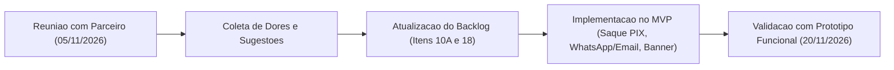
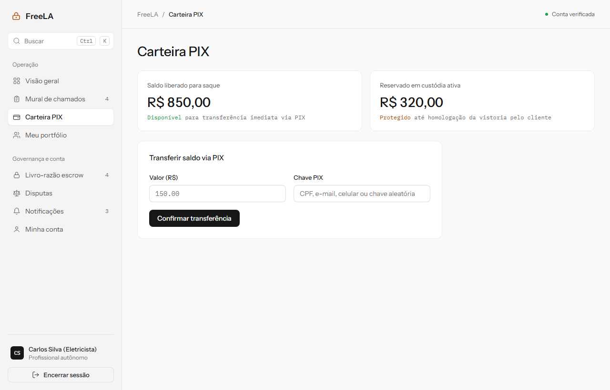
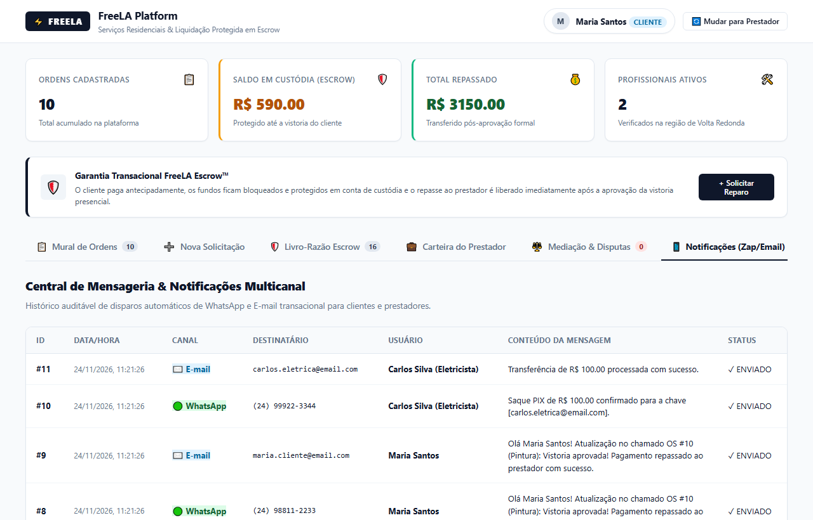

# CENTRO UNIVERSITÁRIO DE BARRA MANSA (UBM)
## CURSO DE ENGENHARIA DE SOFTWARE
### PRÁTICAS EXTENSIONISTAS INTEGRADORAS III

**PROJETO FREELA: REGISTRO DE EVIDÊNCIAS EXTENSIONISTAS**  
**CRITÉRIO DE AVALIAÇÃO C6 (REUNIÕES DE 04/12 E 11/12)**

* **Equipe:** Vinicius Marcello Simões, Kaique, Caio, Yago, Lucas Augusto, Lucas Gabriel
* **Orientação:** Profa. Ma. Laila Alves Santos
* **Parceiro Extensionista:** Comunidade de Moradores e Profissionais Autônomos de Volta Redonda/RJ
* **Data:** 26 de novembro de 2026

---

## 1 CONTEXTO EXTENSIONISTA DO PROJETO

A atuação extensionista do projeto FreeLA ocorre junto a moradores contratantes e profissionais autônomos de manutenção residencial (eletricistas, encanadores e pintores) do município de Volta Redonda/RJ.

O objetivo da parceria é reduzir a insegurança financeira nas contratações informais, oferecendo um fluxo claro de garantia de pagamento em custódia (Escrow) e transparência na aprovação dos serviços.

Figura 1: Ciclo de escuta extensionista e conversão em melhorias no software.  
Fonte: Elaborado pelos autores (2026).

---

## 2 REGISTRO DAS REUNIÕES COM O PARCEIRO

### 2.1 Reunião 1: Levantamento de Dores e Validação de Fluxo
* **Data:** 05 de novembro de 2026.
* **Modalidade e Local:** Encontro presencial e chamada remota com moradores e prestadores de Volta Redonda/RJ.
* **Participantes da Equipe:** Vinicius Marcello Simões, Kaique, Caio, Yago, Lucas Augusto, Lucas Gabriel.
* **Representantes da Comunidade:** Moradores contratantes de serviços residenciais e dois profissionais autônomos locais (área elétrica e hidráulica).
* **Pauta Executada:**
  1. Apresentação da proposta da plataforma FreeLA e do conceito de pagamento retido em custódia.
  2. Demonstração das telas iniciais (solicitação de reparo, envio de orçamento e aprovação pós-serviço).
  3. Coleta de dúvidas, objeções e sugestões práticas de uso no dia a dia.

### 2.2 Reunião 2: Validação do MVP Funcional Pós-Ajustes
* **Data:** 20 de novembro de 2026.
* **Modalidade:** Demonstração assistida com o protótipo navegável em execução.
* **Pauta Executada:**
  1. Apresentação da aba de Carteira do Prestador com solicitação de saque PIX.
  2. Demonstração dos avisos automáticos gerados no fluxo de checkout e vistoria.
  3. Conferência da clareza visual dos valores e taxas exibidos ao cliente.

---

## 3 FEEDBACK RECEBIDO DO PARCEIRO

Durante o contato de 05/11/2026, os participantes registraram quatro apontamentos principais:

1. **Comprovação de Pagamento Retido (Visão do Prestador):**  
   Os profissionais relataram receio de deslocamento sem certeza de pagamento e solicitaram confirmação imediata de que o cliente depositou o valor na plataforma antes da visita.
2. **Facilidade de Resgate Financeiro (Visão do Prestador):**  
   Os profissionais pediram um meio direto para transferir o saldo liberado após a vistoria para sua conta bancária via chave PIX.
3. **Transparência da Taxa de Serviço (Visão do Cliente):**  
   Os moradores solicitaram exibição clara do valor da mão de obra separado da taxa da plataforma antes de confirmar o pagamento.
4. **Comprovantes Acessíveis pelo Celular (Visão Conjunta):**  
   Clientes e prestadores pediram notificações simples enviadas por WhatsApp e e-mail a cada mudança de etapa do serviço.

---

## 4 MUDANÇAS IMPLEMENTADAS NO PROJETO A PARTIR DO FEEDBACK

A Tabela 1 apresenta a rastreabilidade direta entre cada feedback recebido e as alterações concretas realizadas no código, no banco de dados e no backlog do FreeLA.

Tabela 1: Matriz de rastreabilidade entre o feedback extensionista e as entregas no sistema.

| Feedback do Parceiro | Mudança Realizada no Projeto | Evidência Técnica (Código / Backlog) |
|---|---|---|
| Comprovação imediata de valor retido e avisos por celular | Criação do serviço de mensageria multicanal (WhatsApp e e-mail) com registro em banco | `src/services/notificationService.js`, tabela `notificacoes_log`, rota `GET /api/notificacoes` e Item 18 do Backlog |
| Facilidade de resgate do saldo pós-vistoria via PIX | Desmembramento do Item 10 e entrega completa da Carteira Digital com saque PIX na Sprint 1 | `escrowService.processarSaque`, rota `POST /api/prestador/saque`, aba Carteira em `public/index.html` e Item 10A |
| Transparência de taxas e funcionamento da garantia | Inclusão do banner explicativo do FreeLA Escrow™ e discriminação de `valor_mao_obra`, `taxa_plataforma` e `valor_total` | `public/index.html` (banner de garantia) e checkout em `public/js/app.js` |
| Segurança contra liberação indevida sem vistoria | Bloqueio estrito de aprovação quando a ordem está em `EM_EXECUCAO` e validação do cliente titular | `escrowService.liberarRepasse` (HTTP 400 e HTTP 403) validado nos Testes 10 e 11 |

Fonte: Elaborado pelos autores (2026).

---

## 5 EVIDÊNCIAS VISUAIS DAS FUNCIONALIDADES IMPLEMENTADAS

As Figuras 2 e 3 apresentam as telas implementadas no sistema em resposta direta às demandas dos moradores e profissionais autônomos.

Figura 2: Aba Carteira do Prestador com saldo disponível, saldo em custódia e resgate via PIX.  
Fonte: Elaborado pelos autores (2026).

Figura 3: Central de Mensageria exibindo o histórico de avisos automáticos para WhatsApp e e-mail.  
Fonte: Elaborado pelos autores (2026).

> [!NOTE]
> Anexo de comprovação de campo: caso a equipe possua fotografias da reunião ou capturas de tela da conversa de validação com os participantes de Volta Redonda/RJ, inserir as imagens neste espaço antes do envio final no AVA.

---

## REFERÊNCIAS

ASSOCIAÇÃO BRASILEIRA DE NORMAS TÉCNICAS. **NBR 6024:** Informação e documentação: numeração progressiva das seções de um documento escrito: apresentação. Rio de Janeiro: ABNT, 2012.

BRASIL. Ministério da Educação. **Resolução CNE/CES nº 7, de 18 de dezembro de 2018:** Estabelece as Diretrizes para a Extensão na Educação Superior Brasileira. Brasília: MEC, 2018.
