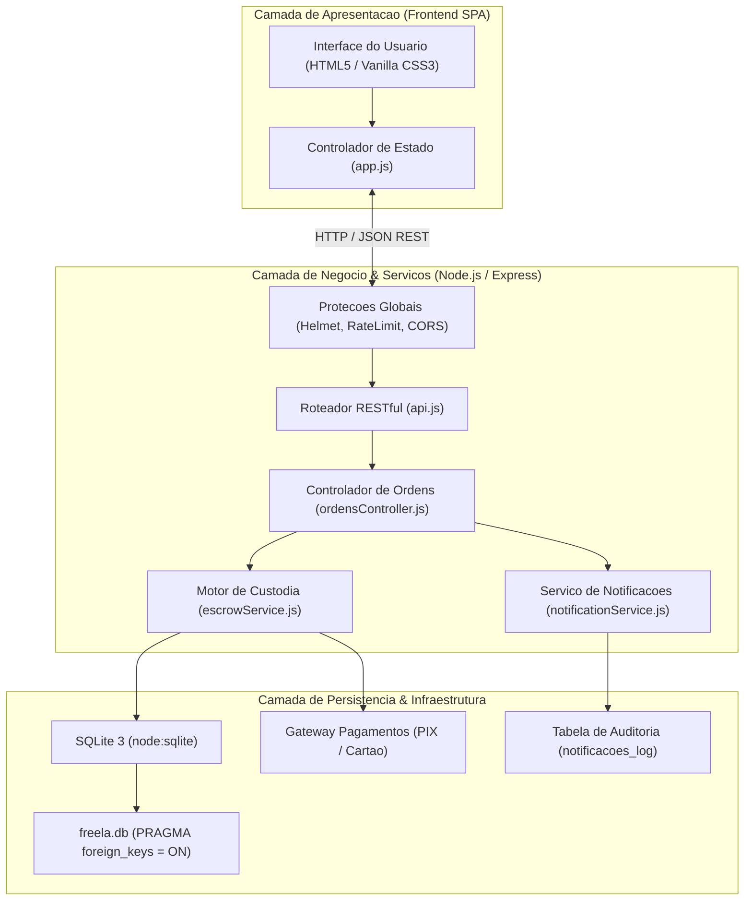

# Manual Técnico Parcial — FreeLA

Versão: 2.0 · Data: 24/11/2026 · Repositório: https://github.com/ViniMSimoes/freela  
Disciplina: Práticas Extensionistas Integradoras III — Engenharia de Software (UBM)  
Orientação: Profa. Ma. Laila Alves Santos  

---

## 1. Público-Alvo e Tarefas

Este manual técnico orienta engenheiros de software, arquitetos e desenvolvedores que atuarão na manutenção, extensão de funcionalidades e auditoria da plataforma FreeLA.

Ao concluir a leitura deste documento, o leitor estará capacitado a:
1. Compreender a arquitetura de três camadas, a separação do motor de custódia (`escrowService.js`) e as responsabilidades dos módulos do sistema (Seção 2).
2. Integrar clientes web, aplicativos móveis ou serviços externos à API RESTful, respeitando contratos JSON, códigos de status HTTP e regras de autenticação e autorização (Seção 3).
3. Identificar os módulos previstos para implementação nas etapas finais da disciplina (Seção 4).

---

## 2. Arquitetura Básica

### 2.1 Visão Geral

O FreeLA adota uma arquitetura em três camadas desacopladas: **Apresentação**, **Serviços & Negócio** e **Persistência**. 

A camada de apresentação consiste em uma Single Page Application (SPA) modular construída em JavaScript Vanilla e CSS3. A interface comunica-se exclusivamente com a API RESTful em Node.js e Express através de requisições assíncronas JSON.

A camada de negócio isola as regras transacionais financeiras em serviços dedicados:
- O **Motor de Custódia (`escrowService.js`)** centraliza a máquina de estados, o bloqueio cautelar de valores e a liquidação irreversível pós-vistoria.
- O **Serviço de Mensageria (`notificationService.js`)** executa notificações automáticas para WhatsApp e E-mail transacional.



### 2.2 Componentes e Responsabilidades

| Componente | Responsabilidade Principal | Tecnologia / Implementação | Localização |
|---|---|---|---|
| **Interface SPA** | Renderiza telas de solicitação, mural de ordens, livro-razão e carteira digital | HTML5, CSS3 Modular (Vanilla/BEM), JS W3C | `public/` |
| **Proteção de Borda** | Bloqueia requisições excessivas (DoS), sanitiza payloads e adiciona cabeçalhos HTTP OWASP | Helmet 8.0, Express Rate Limit 7.5 | `src/server.js` |
| **API Router** | Mapeia as rotas HTTP RESTful e despacha para os controladores responsáveis | Express Router | `src/routes/api.js` |
| **Controlador de Ordens** | Valida parâmetros de entrada, formata saídas e orquestra chamadas aos serviços | JavaScript ES6+ | `src/controllers/ordensController.js` |
| **Motor de Custódia (Escrow Engine)** | Executa retenção, liberação atômica, saques PIX e arbitragem de disputas | Módulo de Negócio Desacoplado | `src/services/escrowService.js` |
| **Serviço de Notificações** | Gerencia disparos multicanal (WhatsApp e E-mail) e persiste logs auditáveis | Serviço Assíncrono com Log em Banco | `src/services/notificationService.js` |
| **Gateway de Pagamentos** | Simula processamento instantâneo via PIX e autorização de Cartão de Crédito | Adaptador Transacional Interno | Integrado a `escrowService.js` |
| **Persistência de Dados** | Executa queries SQL com controle de integridade referencial ativa e transações ACID | `node:sqlite` nativo (`PRAGMA foreign_keys = ON`) | `src/database/` |

### 2.3 Diagrama Arquitetural de Componentes


### 2.4 Decisões Técnicas Fundamentais

1. **Desacoplamento do Motor de Custódia (`escrowService.js`):**
   A lógica de movimentação de saldos, retenção cautelar e aprovação pós-vistoria foi extraída do controlador HTTP para uma classe de serviço independente. Essa separação garante responsabilidade única, simplifica testes unitários e viabiliza a futura transição para processamento assíncrono em mensageria corporativa.

2. **Ativação Obrigatória de Chaves Estrangeiras no SQLite:**
   O SQLite desativa restrições de chave estrangeira por padrão. O adaptador de conexão (`connection.js`) executa `PRAGMA foreign_keys = ON;` no momento da inicialização. Dessa forma, qualquer tentativa de registrar transações ou avaliações vinculadas a ordens inexistentes resulta em rejeição imediata pelo mecanismo do banco de dados.

3. **Arquitetura CSS3 Pura e Ausência de Frameworks Pesados:**
   O frontend utiliza CSS3 modular estruturado pelo método BEM (Block, Element, Modifier). Essa abordagem elimina pré-processadores e dependências de compilação como Tailwind ou Webpack, garantindo velocidade de inicialização e alta portabilidade em qualquer ambiente de desenvolvimento.

---

## 3. Referência Completa da API RESTful

### 3.1 Padrões Globais, Autenticação e Códigos de Retorno

- **Endereço Base:** `http://localhost:3000/api`
- **Formato dos Dados:** Todas as requisições com corpo utilizam o cabeçalho `Content-Type: application/json`. As respostas utilizam `application/json; charset=utf-8`.
- **Envelope de Resposta Padrão:**
  ```json
  {
    "sucesso": true,
    "mensagem": "Texto informativo opcional.",
    "dados": {}
  }
  ```
- **Modelo de Identificação e Controle de Acesso:**
  No estágio MVP, a identidade do requisitante é enviada nos corpos ou cabeçalhos através dos identificadores `cliente_id` e `prestador_id`. O backend valida estritamente a titularidade: um cliente não pode homologar vistorias de ordens que pertençam a outro usuário, retornando `HTTP 403 Forbidden`. O ciclo final da disciplina incluirá autenticação criptográfica via JSON Web Tokens (JWT).

---

### 3.2 Catálogo de Endpoints

#### 1. `GET /stats`
Retorna as métricas consolidadas do painel operacional.
- **Sucesso (`200 OK`):**
  ```json
  {
    "sucesso": true,
    "dados": {
      "total_ordens": 12,
      "ordens_concluidas": 4,
      "saldo_em_custodia": 1420.0,
      "total_repassado": 3850.0,
      "prestadores_ativos": 5
    }
  }
  ```

---

#### 2. `GET /usuarios`
Lista todos os usuários registrados no sistema, com seus respectivos papéis, reputações e saldos.
- **Sucesso (`200 OK`):**
  ```json
  {
    "sucesso": true,
    "dados": [
      {
        "id": 1,
        "nome": "Maria Santos",
        "email": "maria.cliente@email.com",
        "papel": "CLIENTE",
        "telefone": "(24) 98811-2233",
        "reputacao": 5.0,
        "saldo_disponivel": 1500.0,
        "saldo_custodia": 0.0,
        "verificado": 1
      }
    ]
  }
  ```

---

#### 3. `GET /ordens`
Lista as ordens de serviço com filtros opcionais.
- **Query Params:**
  - `status` (opcional): Filtra por status (`PENDENTE`, `EM_CUSTODIA`, `AGUARDANDO_VISTORIA`, `CONCLUIDO`, etc.).
  - `categoria` (opcional): Filtra por categoria (`Elétrica`, `Hidráulica`, `Pintura`, `Alvenaria`, `Climatização`).
- **Sucesso (`200 OK`):**
  ```json
  {
    "sucesso": true,
    "total": 1,
    "dados": [
      {
        "id": 1,
        "cliente_id": 1,
        "prestador_id": 2,
        "categoria": "Elétrica",
        "titulo": "Troca de Disjuntor Geral",
        "status": "EM_CUSTODIA",
        "valor_total": 320.0,
        "cliente_nome": "Maria Santos",
        "prestador_nome": "Carlos Silva (Eletricista)"
      }
    ]
  }
  ```

---

#### 4. `POST /ordens`
Cria uma nova ordem de serviço com sanitização anti-XSS.
- **Body:**
  ```json
  {
    "cliente_id": 1,
    "categoria": "Pintura",
    "titulo": "Pintura de Fachada Externa",
    "descricao": "Aplicação de tinta acrílica lavável em parede externa.",
    "cep": "27255-000",
    "endereco": "Rua 21, nº 45 - Volta Redonda/RJ",
    "urgencia": "MEDIA"
  }
  ```
- **Sucesso (`201 Created`):**
  ```json
  {
    "sucesso": true,
    "mensagem": "Ordem de serviço criada com sucesso!",
    "dados": { "id": 10, "status": "PENDENTE" }
  }
  ```
- **Erros:** `400 Bad Request` caso campos obrigatórios estejam vazios ou categoria/urgência sejam inválidas.

---

#### 5. `GET /ordens/:id`
Retorna os detalhes completos de uma ordem de serviço e todas as propostas concorrentes recebidas.
- **Sucesso (`200 OK`):** Retorna os atributos da ordem e array de `propostas`.
- **Erros:** `404 Not Found` caso o ID não exista.

---

#### 6. `POST /ordens/:id/propostas`
Permite que um prestador envie uma proposta orçamentária para a ordem aberta.
- **Body:**
  ```json
  {
    "prestador_id": 2,
    "valor": 450.0,
    "prazo_estimado": "2 dias úteis",
    "mensagem": "Possuo ferramentas airless para execução rápida."
  }
  ```
- **Sucesso (`201 Created`):** Retorna `proposta_id` gerado e status `PROPOSTA_RECEBIDA` na ordem.
- **Erros:** `400 Bad Request` se o valor for menor ou igual a zero ou se a ordem já estiver contratada.

---

#### 7. `POST /ordens/:id/checkout`
Executa a contratação formal com bloqueio dos fundos no motor de garantia (Escrow).
- **Body:**
  ```json
  {
    "proposta_id": 8,
    "metodo_pagamento": "PIX",
    "cupom": "FREELA10"
  }
  ```
- **Regra de Negócio:** Aplica transação atômica ACID. Aceita a proposta selecionada, recusa as concorrentes, debita/bloqueia fundos e avança status para `EM_CUSTODIA`. Dispara notificação via WhatsApp e E-mail.
- **Sucesso (`200 OK`):**
  ```json
  {
    "sucesso": true,
    "mensagem": "Pagamento processado com sucesso! Os fundos estão retidos em custódia segura.",
    "dados": {
      "ordem_id": 10,
      "status": "EM_CUSTODIA",
      "valor_mao_obra": 450.0,
      "taxa_plataforma": 18.0,
      "valor_total": 468.0
    }
  }
  ```
- **Erros:** `400 Bad Request` caso a ordem já possua custódia ativa (Proteção Anti Double-Spending).

---

#### 8. `PATCH /ordens/:id/status`
Atualiza o estágio operacional da execução da mão de obra.
- **Transições Permitidas:** `A_CAMINHO` ➔ `EM_EXECUCAO` ➔ `AGUARDANDO_VISTORIA`.
- **Body:**
  ```json
  {
    "novo_status": "AGUARDANDO_VISTORIA",
    "foto_conclusao": "https://storage.freela.com/fotos/reparo_concluido.jpg"
  }
  ```
- **Sucesso (`200 OK`):** Atualiza status e notifica o cliente para realizar a vistoria presencial.

---

#### 9. `POST /ordens/:id/aprovar`
Homologa a vistoria presencial e liquida irreversivelmente o saldo de custódia para o prestador.
- **Body:**
  ```json
  {
    "cliente_id": 1,
    "nota": 5,
    "comentario": "Serviço perfeito, entrega pontual e limpeza exemplar."
  }
  ```
- **Regras Estritas de Validação:**
  1. **Validação de Ciclo de Vida:** A ordem deve obrigatoriamente estar com o status `AGUARDANDO_VISTORIA`. Tentativas de aprovação com status `EM_EXECUCAO` são terminantemente rejeitadas com `HTTP 400 Bad Request`.
  2. **Validação de Titularidade (Autorização):** O `cliente_id` informado deve coincidir com o cliente proprietário da ordem de serviço. Tentativas de outros usuários resultam em `HTTP 403 Forbidden`.
- **Sucesso (`200 OK`):**
  ```json
  {
    "sucesso": true,
    "mensagem": "Vistoria aprovada! Pagamento liberado com sucesso para a conta do prestador.",
    "valor_liberado": 450.0,
    "status": "CONCLUIDO"
  }
  ```

---

#### 10. `POST /ordens/:id/disputa`
Abre processo de contestação formal e mediação técnica caso o reparo apresente inconformidades.
- **Body:**
  ```json
  {
    "motivo": "Vazamento persistente no sifão instalado.",
    "detalhes": "Após o término da instalação o armário voltou a inundar."
  }
  ```
- **Efeito:** Congela o saldo em custódia, avança status para `EM_DISPUTA` e notifica o suporte técnico.

---

#### 11. `GET /transacoes`
Retorna o livro-razão financeiro do motor de custódia (Escrow Ledger) para auditoria contábil.
- **Sucesso (`200 OK`):**
  ```json
  {
    "sucesso": true,
    "dados": [
      {
        "id": 16,
        "ordem_id": 10,
        "valor": 450.0,
        "tipo": "LIBERACAO_REPASSE",
        "status": "CONFIRMADO",
        "detalhes": "Vistoria presencial homologada pelo cliente titular. Repasse liquidado.",
        "criado_em": "2026-11-24 08:21:26"
      }
    ]
  }
  ```

---

#### 12. `POST /prestador/saque`
Processa a transferência bancária imediata via PIX do saldo disponível do prestador.
- **Body:**
  ```json
  {
    "prestador_id": 2,
    "valor": 100.0,
    "chave_pix": "carlos.eletrica@email.com"
  }
  ```
- **Sucesso (`200 OK`):**
  ```json
  {
    "sucesso": true,
    "mensagem": "Saque PIX de R$ 100.00 processado com sucesso!",
    "novo_saldo": 3800.0
  }
  ```
- **Erros:** `400 Bad Request` se o valor solicitado exceder o saldo disponível em carteira.

---

#### 13. `POST /disputas/:id/resolver`
Permite à equipe de suporte técnico e arbitragem resolver uma contestação.
- **Body:**
  ```json
  {
    "decisao": "REPASSE_PRESTADOR",
    "justificativa": "Laudo técnico comprovou que o defeito ocorreu em peça antiga não coberta no escopo."
  }
  ```
- **Opções de Decisão:** `REPASSE_PRESTADOR` (libera os fundos ao prestador e marca `CONCLUIDO`) ou `ESTORNO_CLIENTE` (estorna integralmente o cliente e marca `CANCELADO`).

---

#### 14. `GET /notificacoes`
Lista o histórico de mensagens automáticas disparadas pelos canais WhatsApp e E-mail.
- **Sucesso (`200 OK`):** Retorna o array de disparos com canal, destinatário, mensagem e carimbo de data/hora.

---

## 4. Próximas Seções Previstas

Para a versão final consolidada do Manual Técnico da disciplina, as seguintes seções estão programadas para desenvolvimento e documentação:

1. **Seção 5 — Guia de Implantação e Infraestrutura em Nuvem:**
   - Procedimentos para empacotamento em contêineres Docker (`Dockerfile` multi-stage e `docker-compose.yml`).
   - Configuração de proxy reverso Nginx com terminação SSL/TLS (Let's Encrypt).
   - Migração assistida da base de dados do SQLite embutido para instância gerenciada PostgreSQL 16 com pool de conexões `pg.Pool`.

2. **Seção 6 — Especificação de Segurança Avançada & Autenticação:**
   - Implementação do fluxo completo de autenticação via JSON Web Tokens (JWT) com chaves assimétricas RS256.
   - Políticas de renovação de credenciais via *Refresh Tokens* armazenados em cookies HTTP-Only seguros com sinalizador SameSite.
   - Controle de acesso baseado em papéis (RBAC — Role-Based Access Control) com validação de permissões por endpoint.

3. **Seção 7 — Integração Real com Gateways Bancários (BaaS):**
   - Especificação do webhook e assinatura HMAC para integração de pagamentos PIX com provedores de BaaS (Asaas ou Mercado Pago).
   - Conciliação bancária automática com rotina agendada (Cron Job) para detecção de anomalias no livro-razão.

4. **Seção 8 — Manual de Operação e Mediação do Administrador:**
   - Painel web exclusivo para resolução de disputas, histórico de vistorias com foto-comprovação e gestão de taxas da plataforma.
