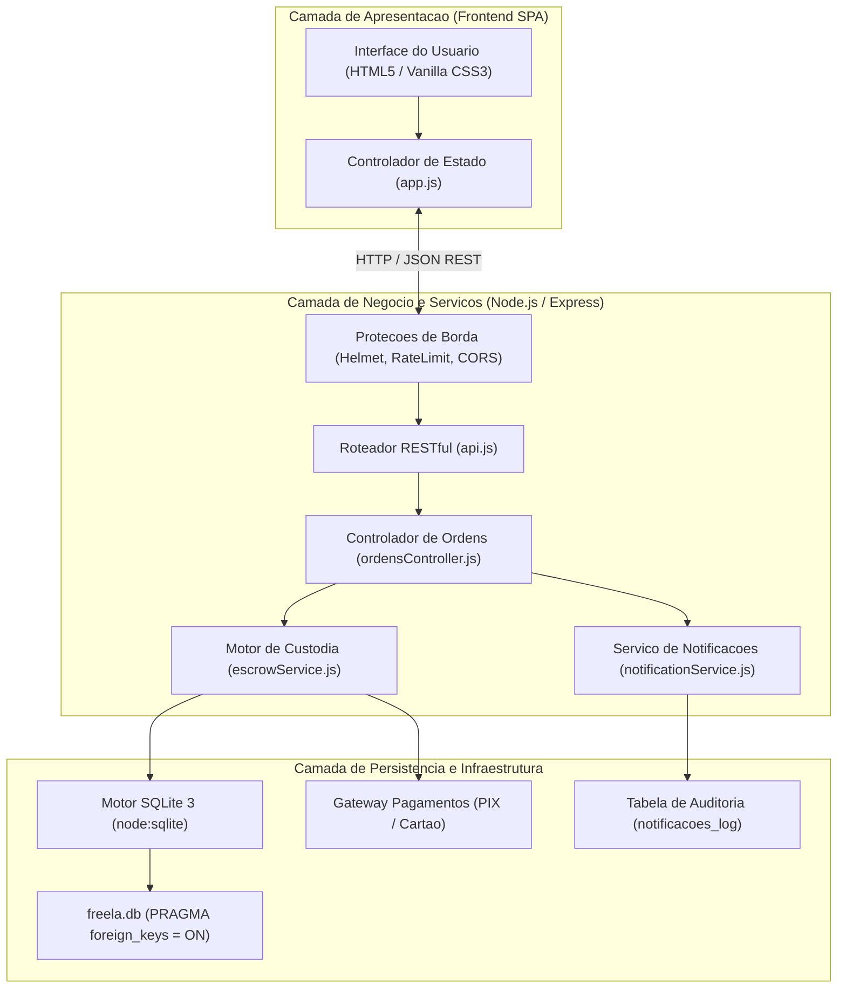
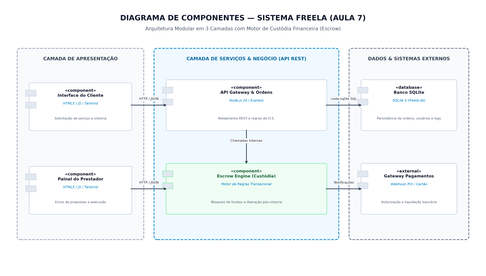

# CENTRO UNIVERSITÁRIO DE BARRA MANSA (UBM)
## CURSO DE ENGENHARIA DE SOFTWARE
### PRÁTICAS EXTENSIONISTAS INTEGRADORAS III

**PROJETO FREELA: PLATAFORMA SAAS DE SERVIÇOS COM CUSTÓDIA FINANCEIRA (ESCROW)**  
**MANUAL TÉCNICO PARCIAL**

* **Equipe de Desenvolvimento:** Vinicius Marcello Simões, Kaique, Caio, Yago, Lucas Augusto, Lucas Gabriel
* **Orientação Docente:** Profa. Ma. Laila Alves Santos
* **Data da Versão:** 24 de novembro de 2026
* **Repositório do Código:** https://github.com/ViniMSimoes/freela

---

## 1 INTRODUÇÃO E PÚBLICO-ALVO

Este manual técnico orienta engenheiros de software, arquitetos e desenvolvedores que realizam a manutenção, a extensão de funcionalidades e a auditoria da plataforma FreeLA.

Ao término da leitura, o leitor adquire capacidade técnica para:
1. Compreender a arquitetura em três camadas, a separação modular do motor de custódia financeira e a responsabilidade de cada componente (Seção 2).
2. Integrar aplicações web, móveis ou serviços de terceiros aos endpoints da API RESTful, atendendo às regras de autorização e contratos de dados (Seção 3).
3. Conhecer o planejamento das seções complementares da versão final do produto (Seção 4).

---

## 2 ARQUITETURA BÁSICA DO SISTEMA

### 2.1 Visão Geral da Arquitetura

O FreeLA adota o modelo de arquitetura em três camadas desacopladas: Apresentação, Serviços de Negócio e Persistência de Dados.

A camada de apresentação opera como uma Single Page Application (SPA) construída em JavaScript Vanilla e CSS3 Modular. A interface interage com a API RESTful construída em Node.js e Express por meio de chamadas assíncronas em formato JSON.

A camada de negócio isola as regras financeiras em módulos de serviços dedicados:
1. O Motor de Custódia (`escrowService.js`) gerencia a máquina de estados, o bloqueio cautelar de saldos e a liquidação irreversível após vistoria presencial.
2. O Serviço de Notificações (`notificationService.js`) processa o envio assíncrono de alertas para canais externos (WhatsApp e E-mail) e persiste logs auditáveis.

A Figura 1 detalha o fluxo lógico entre as três camadas do sistema.



Figura 1: Arquitetura em camadas e comunicação de serviços do FreeLA.  
Fonte: Autores (2026).

---

### 2.2 Componentes e Responsabilidades

A Tabela 1 lista os módulos centrais da plataforma, detalha as respectivas responsabilidades e indica sua localização no repositório.

Tabela 1: Matriz de componentes do sistema e suas responsabilidades.

| Componente | Responsabilidade Principal | Tecnologia Empregada | Localização no Repositório |
|---|---|---|---|
| Interface do Usuário | Renderiza telas de triagem, mural com filtros, checkout e carteira | HTML5, CSS3 Modular (BEM), JS W3C | `public/` |
| Proteção de Borda | Aplica cabeçalhos OWASP, rate limiting e sanitização de payloads | Helmet 8.0 e Express Rate Limit 7.5 | `src/server.js` |
| Roteador da API | Mapeia as rotas HTTP e delega requisições aos controladores | Express Router | `src/routes/api.js` |
| Controlador de Ordens | Valida dados de entrada e orquestra chamadas de serviços | JavaScript ES6+ | `src/controllers/ordensController.js` |
| Motor de Custódia | Bloqueia saldos, liquida repasses, processa saques e arbitragens | Classe de Serviço Desacoplada | `src/services/escrowService.js` |
| Serviço de Notificações | Despacha alertas e persiste logs auditáveis de mensagens | Serviço Assíncrono com Log Relacional | `src/services/notificationService.js` |
| Gateway de Pagamentos | Simula cobrança via PIX e autorização de cartão de crédito | Módulo Interno de Transações | Integrado a `src/services/escrowService.js` |
| Persistência Relacional | Armazena entidades com garantia ACID e integridade referencial | SQLite 3 Nativo (`node:sqlite`) | `src/database/` |

Fonte: Autores (2026).

---

### 2.3 Diagrama Arquitetural de Componentes

A Figura 2 apresenta a distribuição física e lógica dos módulos do FreeLA.



Figura 2: Diagrama de componentes e interfaces da plataforma FreeLA.  
Fonte: Autores (2026).

---

### 2.4 Decisões Técnicas Fundamentais

1. **Desacoplamento do Serviço de Escrow:**  
   A lógica de transações financeiras reside na classe de domínio `EscrowService`. O controlador HTTP atua exclusivamente na validação do protocolo web e delega as operações financeiras para a camada de serviço. Isso viabiliza testes unitários isolados e garante alta coesão.

2. **Ativação Obrigatória de Integridade Referencial:**  
   O adaptador `connection.js` executa a instrução `PRAGMA foreign_keys = ON;` no momento da abertura do banco. O motor do SQLite passa a rejeitar qualquer tentativa de persistir transações ou avaliações vinculadas a ordens inexistentes.

3. **Arquitetura Visual em CSS3 Modular:**  
   A interface gráfica adota regras nativas de CSS3 estruturadas na metodologia BEM (Block, Element, Modifier). A plataforma elimina ferramentas complexas de empacotamento, garantindo carregamento rápido e manutenção direta.

---

## 3 REFERÊNCIA COMPLETA DA API RESTFUL

### 3.1 Padrões de Comunicação e Autorização

* **Endereço Base da API:** `http://localhost:3000/api`
* **Formato dos Dados:** Todas as mensagens utilizam `Content-Type: application/json`.
* **Formato de Resposta Padrão:** As respostas da API adotam o seguinte padrão:
  ```json
  {
    "sucesso": true,
    "mensagem": "Operação realizada com sucesso.",
    "dados": {}
  }
  ```
* **Modelo de Autorização do MVP:**  
  Nesta versão, a autorização baseia-se nos identificadores de usuário (`cliente_id` e `prestador_id`) fornecidos na requisição. O servidor valida a titularidade do chamado: tentativas de aprovação de vistoria enviadas por usuários distintos do cliente titular recebem status `HTTP 403 Forbidden`. O ciclo seguinte adicionará autenticação por tokens criptográficos JWT.

---

### 3.2 Catálogo de Endpoints da Plataforma

#### 3.2.1 `GET /stats`
Retorna os indicadores consolidados da plataforma para exibição no painel administrativo.
* **Código de Sucesso:** `200 OK`
* **Exemplo de Resposta:**
  ```json
  {
    "sucesso": true,
    "dados": {
      "total_ordens": 12,
      "ordens_concluidas": 4,
      "saldo_em_custodia": 1420.0,
      "total_repassado": 3850.0,
      "prestadores_ativos": 5
    }
  }
  ```

#### 3.2.2 `GET /usuarios`
Retorna a listagem dos usuários cadastrados com papéis, reputações e saldos.
* **Código de Sucesso:** `200 OK`
* **Exemplo de Resposta:**
  ```json
  {
    "sucesso": true,
    "dados": [
      {
        "id": 1,
        "nome": "Maria Santos",
        "email": "maria.cliente@email.com",
        "papel": "CLIENTE",
        "telefone": "(24) 98811-2233",
        "reputacao": 5.0,
        "saldo_disponivel": 1500.0,
        "saldo_custodia": 0.0,
        "verificado": 1
      }
    ]
  }
  ```

#### 3.2.3 `GET /ordens`
Lista as ordens de serviço registradas com suporte a parâmetros de busca.
* **Parâmetros Opcionais (Query):**
  * `status`: Filtra por estado operacional (`PENDENTE`, `EM_CUSTODIA`, `AGUARDANDO_VISTORIA`, `CONCLUIDO`).
  * `categoria`: Filtra por área de atuação (`Elétrica`, `Hidráulica`, `Pintura`, `Alvenaria`, `Climatização`).
* **Código de Sucesso:** `200 OK`

#### 3.2.4 `POST /ordens`
Registra um novo chamado de reparo residencial com sanitização de texto anti-XSS.
* **Corpo da Requisição (JSON):**
  ```json
  {
    "cliente_id": 1,
    "categoria": "Pintura",
    "titulo": "Pintura de Fachada Externa",
    "descricao": "Aplicação de tinta acrílica lavável na parede externa.",
    "cep": "27255-000",
    "endereco": "Rua 21, nº 45, Volta Redonda/RJ",
    "urgencia": "MEDIA"
  }
  ```
* **Código de Sucesso:** `201 Created`
* **Tratamento de Erros:** Retorna `400 Bad Request` caso ocorram campos obrigatórios em branco ou valores fora das listas permitidas.

#### 3.2.5 `GET /ordens/:id`
Recupera os dados completos de uma ordem de serviço, incluindo propostas de prestadores e histórico financeiro.
* **Código de Sucesso:** `200 OK`
* **Tratamento de Erros:** Retorna `404 Not Found` quando a ordem não existe.

#### 3.2.6 `POST /ordens/:id/propostas`
Cadastra a proposta orçamentária de um profissional autônomo para o chamado aberto.
* **Corpo da Requisição (JSON):**
  ```json
  {
    "prestador_id": 2,
    "valor": 450.0,
    "prazo_estimado": "2 dias úteis",
    "mensagem": "Possuo equipamentos próprios para execução rápida."
  }
  ```
* **Código de Sucesso:** `201 Created`
* **Tratamento de Erros:** Retorna `400 Bad Request` caso o valor seja menor ou igual a zero.

#### 3.2.7 `POST /ordens/:id/checkout`
Confirma a contratação da proposta e bloqueia o montante total na conta de garantia (Escrow).
* **Corpo da Requisição (JSON):**
  ```json
  {
    "proposta_id": 8,
    "metodo_pagamento": "PIX",
    "cupom": "FREELA10"
  }
  ```
* **Regra Transacional:** Executa transação ACID atômica. Atualiza a proposta para `ACEITA`, recusa as demais propostas concorrentes, retém o saldo e notifica o usuário via WhatsApp e E-mail.
* **Código de Sucesso:** `200 OK`
* **Tratamento de Erros:** Retorna `400 Bad Request` se a ordem já estiver contratada (prevenção contra pagamento duplicado).

#### 3.2.8 `PATCH /ordens/:id/status`
Atualiza o estágio de execução do conserto no local da residência.
* **Transições Permitidas:** `A_CAMINHO` ➔ `EM_EXECUCAO` ➔ `AGUARDANDO_VISTORIA`.
* **Corpo da Requisição (JSON):**
  ```json
  {
    "novo_status": "AGUARDANDO_VISTORIA",
    "foto_conclusao": "https://storage.freela.com/reparo_finalizado.jpg"
  }
  ```
* **Código de Sucesso:** `200 OK`

#### 3.2.9 `POST /ordens/:id/aprovar`
Homologa a vistoria presencial e liquida o pagamento em favor do prestador.
* **Corpo da Requisição (JSON):**
  ```json
  {
    "cliente_id": 1,
    "nota": 5,
    "comentario": "Serviço aprovado na vistoria presencial."
  }
  ```
* **Regras Estritas de Validação:**
  1. A ordem precisa estar com status `AGUARDANDO_VISTORIA`. O sistema bloqueia a aprovação caso a ordem esteja em `EM_EXECUCAO`, retornando `HTTP 400 Bad Request`.
  2. O `cliente_id` informado deve coincidir com o proprietário do chamado. Usuários não autorizados recebem `HTTP 403 Forbidden`.
* **Código de Sucesso:** `200 OK`

#### 3.2.10 `POST /ordens/:id/disputa`
Abre contestação formal por serviço inconforme, congelando a custódia financeira e acionando o suporte.
* **Corpo da Requisição (JSON):**
  ```json
  {
    "motivo": "Vazamento persistente no cano instalado.",
    "detalhes": "O armário voltou a inundar após a troca do sifão."
  }
  ```
* **Código de Sucesso:** `200 OK`

#### 3.2.11 `GET /transacoes`
Retorna o livro-razão financeiro de custódia (Escrow Ledger) para auditoria contábil.
* **Código de Sucesso:** `200 OK`

#### 3.2.12 `POST /prestador/saque`
Processa o resgate bancário instantâneo via PIX do saldo disponível na carteira do prestador.
* **Corpo da Requisição (JSON):**
  ```json
  {
    "prestador_id": 2,
    "valor": 100.0,
    "chave_pix": "carlos.eletrica@email.com"
  }
  ```
* **Código de Sucesso:** `200 OK`
* **Tratamento de Erros:** Retorna `400 Bad Request` caso o valor solicitado supere o saldo disponível.

#### 3.2.13 `POST /disputas/:id/resolver`
Permite ao suporte técnico arbitrar uma contestação.
* **Corpo da Requisição (JSON):**
  ```json
  {
    "decisao": "REPASSE_PRESTADOR",
    "justificativa": "Laudo confirmou conformidade da mão de obra executada."
  }
  ```
* **Valores Permitidos para Decisão:** `REPASSE_PRESTADOR` (conclui o chamado e transfere o dinheiro) ou `ESTORNO_CLIENTE` (cancela o chamado e devolve o valor ao cliente).
* **Código de Sucesso:** `200 OK`

#### 3.2.14 `GET /notificacoes`
Lista o histórico auditável de disparos automáticos para WhatsApp e E-mail.
* **Código de Sucesso:** `200 OK`

---

## 4 PRÓXIMAS SEÇÕES PREVISTAS

Para a entrega final da disciplina, o manual receberá as seguintes seções adicionais:

1. **Seção 5: Guia de Implantação e Infraestrutura em Nuvem:**  
   Documentará o empacotamento em contêineres Docker, a configuração de proxy reverso Nginx com certificado TLS e o roteiro de migração da base de dados para o PostgreSQL 16.

2. **Seção 6: Especificação de Segurança e Autenticação Criptográfica:**  
   Detalhará a emissão de tokens JWT com chaves assimétricas RS256, políticas de renovação por refresh tokens e controle de acesso RBAC (Role-Based Access Control).

3. **Seção 7: Integração com Gateways Bancários Reais (BaaS):**  
   Descreverá os contratos de webhook, validação de assinaturas HMAC e rotinas de conciliação bancária automática com serviços bancários.

4. **Seção 8: Manual Operacional da Mediação Administrativa:**  
   Orientará os operadores no uso do painel de auditoria, análise de laudos técnicos e resolução de disputas complexas.

---

## REFERÊNCIAS

ASSOCIAÇÃO BRASILEIRA DE NORMAS TÉCNICAS. **NBR 6024:** Informação e documentação: numeração progressiva das seções de um documento escrito: apresentação. Rio de Janeiro: ABNT, 2012.

FIELDING, Roy Thomas. **Architectural Styles and the Design of Network-based Software Architectures**. 2000. Tese (Doutorado em Ciência da Computação) – University of California, Irvine, 2000.

OPEN WEB APPLICATION SECURITY PROJECT (OWASP). **OWASP Top 10: The Ten Most Critical Web Application Security Risks**. OWASP Foundation, 2021.
