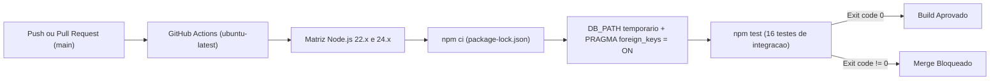
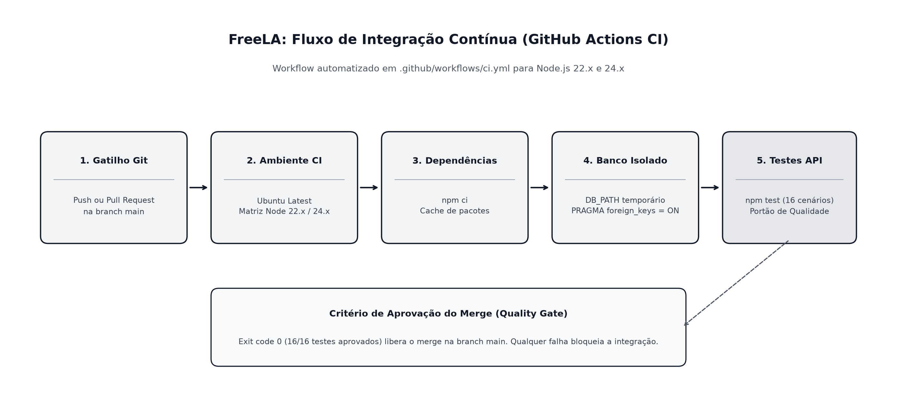

# CENTRO UNIVERSITÁRIO DE BARRA MANSA (UBM)
## CURSO DE ENGENHARIA DE SOFTWARE
### PRÁTICAS EXTENSIONISTAS INTEGRADORAS III

**PROJETO FREELA: PLANEJAMENTO DAS APIS E DA INTEGRAÇÃO CONTÍNUA**  
**CRITÉRIO DE AVALIAÇÃO C5 (REUNIÕES DE 04/12 E 11/12)**

* **Equipe:** Vinicius Marcello Simões, Kaique, Caio, Yago, Lucas Augusto, Lucas Gabriel
* **Orientação:** Profa. Ma. Laila Alves Santos
* **Data:** 26 de novembro de 2026
* **Repositório:** https://github.com/ViniMSimoes/freela

---

## 1 INTRODUÇÃO E ESCOPO DO DOCUMENTO

Este documento especifica os contratos dos endpoints principais da API RESTful do FreeLA e descreve a estratégia de Integração Contínua (CI) executada no repositório do projeto.

A especificação cobre rotas, métodos HTTP, estruturas JSON de entrada e saída, códigos de status e o fluxo automatizado de verificação em `.github/workflows/ci.yml`.

---

## 2 PLANEJAMENTO DOS ENDPOINTS PRINCIPAIS DA API

A API RESTful opera sob o prefixo `/api` na porta configurada em `.env` (padrão `3000`). Todas as requisições com corpo utilizam `Content-Type: application/json`. As respostas seguem o formato padrão `{ "sucesso": boolean, "mensagem"?: string, "dados"?: object|array }`.

### 2.1 Resumo Estrutural das Rotas Principais

A Tabela 1 consolida os endpoints principais da plataforma com método HTTP, rota, dados de entrada e dados de saída.

Tabela 1: Especificação resumida dos endpoints principais da API FreeLA.

| Método | Rota | Dados de Entrada | Dados de Saída (Sucesso) |
|---|---|---|---|
| `GET` | `/api/ordens` | Query opcional: `status`, `categoria` | `200 OK` com `total` e lista `dados` |
| `POST` | `/api/ordens` | JSON: `cliente_id`, `categoria`, `titulo`, `descricao`, `cep`, `endereco`, `urgencia` | `201 Created` com `id` e `status: "PENDENTE"` |
| `POST` | `/api/ordens/:id/propostas` | Param: `id`; JSON: `prestador_id`, `valor`, `prazo_estimado`, `mensagem` | `201 Created` com `proposta_id` |
| `POST` | `/api/ordens/:id/checkout` | Param: `id`; JSON: `proposta_id`, `metodo_pagamento`, `cupom` | `200 OK` com valores calculados e `status: "EM_CUSTODIA"` |
| `PATCH` | `/api/ordens/:id/status` | Param: `id`; JSON: `novo_status`, `foto_conclusao` | `200 OK` com `novo_status` |
| `POST` | `/api/ordens/:id/aprovar` | Param: `id`; JSON: `cliente_id`, `nota`, `comentario` | `200 OK` com `valor_liberado` e `status: "CONCLUIDO"` |
| `POST` | `/api/ordens/:id/disputa` | Param: `id`; JSON: `motivo`, `detalhes` | `200 OK` com `status: "EM_DISPUTA"` |
| `POST` | `/api/disputas/:id/resolver` | Param: `id`; JSON: `decisao`, `justificativa` | `200 OK` com `status_final` |
| `POST` | `/api/prestador/saque` | JSON: `prestador_id`, `valor`, `chave_pix` | `200 OK` com `novo_saldo` |
| `GET` | `/api/transacoes` | Nenhum | `200 OK` com livro-razão em `dados` |
| `GET` | `/api/notificacoes` | Nenhum | `200 OK` com histórico de avisos em `dados` |

Fonte: Elaborado pelos autores (2026).

---

### 2.2 Detalhamento dos Contratos de Entrada e Saída

#### 2.2.1 `POST /api/ordens` (Criação de Ordem de Serviço)
* **Entrada (JSON):**
  ```json
  {
    "cliente_id": 1,
    "categoria": "Elétrica",
    "titulo": "Troca de Disjuntor Geral",
    "descricao": "Disjuntor desarmando ao ligar o chuveiro.",
    "cep": "27253-000",
    "endereco": "Rua 16, n 142, Volta Redonda/RJ",
    "urgencia": "ALTA"
  }
  ```
* **Saída (`201 Created`):**
  ```json
  {
    "sucesso": true,
    "mensagem": "Ordem de serviço criada com sucesso!",
    "dados": {
      "id": 4,
      "status": "PENDENTE",
      "titulo": "Troca de Disjuntor Geral"
    }
  }
  ```
* **Erros previstos:** `400 Bad Request` quando há campos obrigatórios vazios ou categoria inválida.

#### 2.2.2 `POST /api/ordens/:id/checkout` (Bloqueio em Custódia Escrow)
* **Entrada (JSON):**
  ```json
  {
    "proposta_id": 2,
    "metodo_pagamento": "PIX",
    "cupom": "FREELA10"
  }
  ```
* **Saída (`200 OK`):**
  ```json
  {
    "sucesso": true,
    "mensagem": "Pagamento processado com sucesso! Os fundos estão retidos em custódia segura.",
    "dados": {
      "ordem_id": 4,
      "status": "EM_CUSTODIA",
      "valor_mao_obra": 450,
      "taxa_plataforma": 18,
      "valor_total": 468,
      "prestador_id": 2
    }
  }
  ```
* **Erros previstos:** `400 Bad Request` se a ordem já possuir pagamento confirmado (proteção contra pagamento duplicado).

#### 2.2.3 `POST /api/ordens/:id/aprovar` (Homologação da Vistoria e Repasse)
* **Entrada (JSON):**
  ```json
  {
    "cliente_id": 1,
    "nota": 5,
    "comentario": "Serviço concluído conforme o combinado."
  }
  ```
* **Saída (`200 OK`):**
  ```json
  {
    "sucesso": true,
    "mensagem": "Vistoria aprovada! Pagamento liberado com sucesso para a conta do prestador.",
    "valor_liberado": 450,
    "status": "CONCLUIDO"
  }
  ```
* **Erros previstos:**
  * `400 Bad Request` se a ordem estiver em status diferente de `AGUARDANDO_VISTORIA` (como `EM_EXECUCAO`).
  * `403 Forbidden` se o `cliente_id` informado diferir do proprietário da ordem.

#### 2.2.4 `POST /api/prestador/saque` (Resgate PIX)
* **Entrada (JSON):**
  ```json
  {
    "prestador_id": 2,
    "valor": 100.0,
    "chave_pix": "carlos.eletrica@email.com"
  }
  ```
* **Saída (`200 OK`):**
  ```json
  {
    "sucesso": true,
    "mensagem": "Saque PIX de R$ 100.00 processado com sucesso para a chave: carlos.eletrica@email.com!",
    "novo_saldo": 1200
  }
  ```
* **Erros previstos:** `400 Bad Request` quando o valor solicitado excede o saldo disponível.

---

## 3 ESTRATÉGIA DE INTEGRAÇÃO CONTÍNUA (CI)

A estratégia de Integração Contínua do FreeLA automatiza a instalação, o isolamento do banco de dados e a execução dos 16 testes de integração a cada alteração enviada ao repositório no GitHub.

### 3.1 Fluxo de Branches e Portão de Qualidade

1. Os desenvolvedores criam commits semânticos e submetem alterações via `push` ou `pull_request` direcionados à branch principal `main`.
2. O arquivo `.github/workflows/ci.yml` aciona automaticamente o servidor de integração contínua do GitHub Actions em ambiente Linux (`ubuntu-latest`).
3. A pipeline executa uma matriz com duas versões suportadas do runtime: **Node.js 22.x** e **Node.js 24.x**.
4. O workflow executa `npm ci` para instalar exatamente as versões travadas em `package-lock.json`.
5. O ambiente configura uma base SQLite limpa e temporária (`DB_PATH=./freela_ci_test.db`) e executa `npm test`.
6. A integração na branch `main` é aprovada somente quando todos os 16 testes retornam código de saída `0`.



Figura 1: Fluxo lógico da pipeline de Integração Contínua no GitHub Actions.  
Fonte: Elaborado pelos autores (2026).

### 3.2 Representação Gráfica da Pipeline CI



Figura 2: Etapas automatizadas do workflow `.github/workflows/ci.yml`.  
Fonte: Elaborado pelos autores (2026).

### 3.3 Cobertura Automatizada na Pipeline

A suíte `tests/api.test.js` executada no CI valida automaticamente:
1. Cabeçalhos de segurança HTTP (Helmet) e ausência de `X-Powered-By`.
2. Sanitização de entradas contra XSS em criação de ordens.
3. Bloqueio de valores negativos em propostas e prevenção de pagamento duplo no checkout.
4. Bloqueio de aprovação prematura em `EM_EXECUCAO` (HTTP 400) e proteção de titularidade (HTTP 403).
5. Integridade referencial ativa (`PRAGMA foreign_keys = ON`) rejeitando registros órfãos.

---

## REFERÊNCIAS

ASSOCIAÇÃO BRASILEIRA DE NORMAS TÉCNICAS. **NBR 6024:** Informação e documentação: numeração progressiva das seções de um documento escrito: apresentação. Rio de Janeiro: ABNT, 2012.

FOWLER, Martin. **Continuous Integration**. 2006. Disponível em: https://martinfowler.com/articles/continuousIntegration.html. Acesso em: 26 nov. 2026.

GITHUB. **GitHub Actions Documentation**. GitHub Inc., 2026. Disponível em: https://docs.github.com/actions. Acesso em: 26 nov. 2026.
