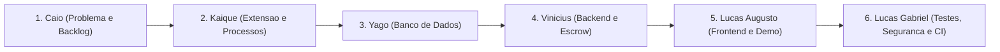

# CENTRO UNIVERSITÁRIO DE BARRA MANSA (UBM)
## CURSO DE ENGENHARIA DE SOFTWARE
### PRÁTICAS EXTENSIONISTAS INTEGRADORAS III

**PROJETO FREELA: ROTEIRO DE APRESENTAÇÃO FINAL E DEFESA TÉCNICA**  
**CRITÉRIO DE AVALIAÇÃO C7 (REUNIÕES DE 04/12 E 11/12)**

* **Equipe:** Vinicius Marcello Simões, Kaique, Caio, Yago, Lucas Augusto, Lucas Gabriel
* **Orientação:** Profa. Ma. Laila Alves Santos
* **Duração Prevista da Apresentação:** 12 a 15 minutos (mais arguição da banca)
* **Data:** 26 de novembro de 2026

---

## 1 OBJETIVO E ESTRATÉGIA DA APRESENTAÇÃO

Este roteiro organiza a apresentação final do projeto FreeLA para garantir exposição clara do problema, demonstração prática do MVP em execução, participação equilibrada dos seis integrantes e preparo técnico para responder às perguntas da docente.

Figura 1: Sequência de apresentação e divisão de blocos entre os seis integrantes.  
Fonte: Elaborado pelos autores (2026).

---

## 2 DIVISÃO DE BLOCOS ENTRE OS INTEGRANTES

A Tabela 1 define o tempo, o tema e os pontos obrigatórios de fala de cada membro da equipe.

Tabela 1: Distribuição equilibrada da apresentação entre os integrantes.

| Ordem | Integrante | Tempo | Bloco de Responsabilidade | Pontos-Chave na Fala |
|---|---|---|---|---|
| **1** | **Caio** | 2 min | Contexto, Problema e Product Backlog (C3) | Dor de clientes e autônomos; evolução de 13 para 19 itens; 15 concluídos (78,9%); distinção entre Item 3 (habilitador) e Item 4 (história). |
| **2** | **Kaique** | 2 min | Evidências Extensionistas e Regras de Negócio (C6) | Reuniões com moradores e prestadores de Volta Redonda; feedback recebido; entregas resultantes (saque PIX e notificações WhatsApp/e-mail). |
| **3** | **Yago** | 2 min | Estrutura do Banco de Dados (C4) | 6 tabelas em 3FN no SQLite (`node:sqlite`); `PRAGMA foreign_keys = ON`; chaves em `avaliacoes`; cardinalidade 1:N mútua; plano de migração PostgreSQL. |
| **4** | **Vinicius Marcello Simões** | 3 min | Arquitetura, API REST e Motor Escrow (C2 e C5) | Arquitetura em 3 camadas; desacoplamento em `escrowService.js`; transações ACID; bloqueio de aprovação em `EM_EXECUCAO`; validação de titularidade (`HTTP 403`). |
| **5** | **Lucas Augusto** | 3 min | Demonstração ao Vivo da Interface SPA | Fluxo completo no navegador: criar ordem, enviar proposta, checkout com cupom `FREELA10`, avançar até `AGUARDANDO_VISTORIA`, aprovar, sacar PIX e ver logs. |
| **6** | **Lucas Gabriel** | 2 min | Qualidade, Segurança, Testes e CI (C1 e C5) | Execução de `npm test` ao vivo (16 testes); Helmet e Rate Limit; pipeline `.github/workflows/ci.yml` em Node 22.x e 24.x; fechamento da equipe. |

Fonte: Elaborado pelos autores (2026).

---

## 3 ROTEIRO DA DEMONSTRAÇÃO PRÁTICA (AO VIVO)

Durante o bloco 5 (Lucas Augusto) com apoio de Vinicius e Lucas Gabriel no terminal:

1. **Inicialização Segura:** executar `npm start` no terminal, mostrando o carregamento do `.env` via `dotenv`, as proteções ativas (Helmet, Rate Limiting, Sanitização) e a porta `3000`.
2. **Criação de Ordem (Visão Cliente):** abrir `http://localhost:3000`, clicar em "+ Solicitar Reparo", cadastrar um serviço e mostrar a ordem entrando no mural com status `PENDENTE`.
3. **Orçamento (Visão Prestador):** alternar para o perfil Prestador no topo da tela e enviar uma proposta de mão de obra.
4. **Checkout em Custódia (Visão Cliente):** retornar para Cliente, aceitar a proposta aplicando o cupom `FREELA10` e mostrar na aba **Livro-Razão Escrow** o registro `BLOQUEIO_ESCROW`.
5. **Execução e Vistoria:** avançar a ordem como Prestador (`A Caminho` ➔ `Iniciar Reparo` ➔ `Concluir Reparo`), destacando que o sistema bloqueia pagamento antes de `AGUARDANDO_VISTORIA`.
6. **Aprovação e Saque PIX:** aprovar a vistoria como Cliente, conferir na aba **Carteira do Prestador** o saldo liberado, realizar um saque PIX e mostrar na aba **Notificações (Zap/Email)** os registros persistidos.
7. **Suíte de Testes:** executar `npm test` no terminal exibindo os 16 testes aprovados.

---

## 4 BANCO DE PERGUNTAS E RESPOSTAS PARA A DEFESA TÉCNICA

A Tabela 2 prepara todos os integrantes para responder com segurança às perguntas técnicas da avaliação.

Tabela 2: Guia de perguntas frequentes da banca e respostas técnicas objetivas.

| Pergunta Técnica da Banca | Responsável Principal | Resposta Técnica Objetiva |
|---|---|---|
| Por que o sistema exige Node.js `>= 22.5.0` e exibe um aviso experimental? | Vinicius / Lucas Gabriel | O projeto usa o módulo nativo `node:sqlite` embutido no Node.js a partir da versão 22.5.0. No Node 22, o runtime exibe `ExperimentalWarning` porque a API nativa ainda possui selo experimental, sem afetar a estabilidade. |
| Como vocês garantem que o dinheiro não seja liberado antes da vistoria ou por outro usuário? | Vinicius | Em `src/services/escrowService.js`, o método `liberarRepasse` valida duas condições obrigatórias: o status precisa ser estritamente `AGUARDANDO_VISTORIA` (retorna `HTTP 400` se estiver em `EM_EXECUCAO`) e o `cliente_id` precisa coincidir com `ordem.cliente_id` (retorna `HTTP 403` caso contrário). |
| Como o sistema evita pagamento duplicado (double-spending) no checkout? | Vinicius / Yago | O método `bloquearCustodia` verifica o status inicial (`PENDENTE` ou `PROPOSTA_RECEBIDA`) e encapsula a atualização das propostas, da ordem, do saldo e do livro-razão em uma transação atômica (`BEGIN TRANSACTION` e `COMMIT`/`ROLLBACK`). |
| Por que foi preciso colocar `PRAGMA foreign_keys = ON` no SQLite? | Yago | O SQLite desativa a verificação de chaves estrangeiras por padrão. Sem esse comando em `src/database/connection.js`, o banco aceitaria registros órfãos. O Teste 16 comprova que inserções com chave inexistente são rejeitadas. |
| Por que a avaliação tem cardinalidade 1:N e não 1:1? | Yago / Caio | O requisito do backlog prevê avaliação mútua bilateral: o cliente avalia o prestador e o prestador avalia o cliente sobre a mesma ordem de serviço. Logo, uma ordem comporta mais de uma avaliação (1:N). |
| Como a migração para PostgreSQL difere de apenas trocar a conexão? | Yago | Exige troca de tipos e recursos: `BIGINT GENERATED ALWAYS AS IDENTITY` nas chaves, `BOOLEAN` e `TIMESTAMPTZ` nativos, pool de conexões com `pg.Pool` e nível de isolamento `SERIALIZABLE` nas transações de custódia. |
| O que mudou no projeto após a reunião com o parceiro extensionista? | Kaique / Caio | O encontro de 05/11/2026 com moradores e autônomos de Volta Redonda motivou a entrega antecipada do saque PIX (Item 10A), a criação das notificações multicanal WhatsApp e e-mail (Item 18) e o banner explicativo das taxas. |
| Como funciona a integração contínua do repositório? | Lucas Gabriel | O workflow `.github/workflows/ci.yml` executa automaticamente a cada `push` ou `pull_request` na branch `main`, testando o projeto em Node 22.x e 24.x com `npm ci` e `npm test` sobre um banco SQLite limpo. |
| Quais proteções de segurança existem na API? | Lucas Gabriel / Lucas Augusto | O `server.js` aplica Helmet (CSP, `nosniff`, `SAMEORIGIN`, remoção de `X-Powered-By`), Rate Limit (200 requisições por 15 min por IP), limite de JSON em 100 KB e sanitização de HTML contra XSS no controller e no frontend. |

Fonte: Elaborado pelos autores (2026).

---

## 5 CHECKLIST FINAL ANTES DA APRESENTAÇÃO

1. Conferir se o arquivo `.env` existe na raiz com `PORT=3000` e `DB_PATH=./freela.db`.
2. Executar `npm test` antes da apresentação para confirmar os 16 testes aprovados.
3. Deixar o repositório `https://github.com/ViniMSimoes/freela` aberto no navegador mostrando a aba Actions (CI) e os commits recentes.
4. Garantir que cada integrante revise suas falas na Tabela 1 e as respostas correspondentes na Tabela 2.

---

## REFERÊNCIAS

ASSOCIAÇÃO BRASILEIRA DE NORMAS TÉCNICAS. **NBR 6024:** Informação e documentação: numeração progressiva das seções de um documento escrito: apresentação. Rio de Janeiro: ABNT, 2012.

ASSOCIAÇÃO BRASILEIRA DE NORMAS TÉCNICAS. **NBR 14724:** Informação e documentação: trabalhos acadêmicos: apresentação. Rio de Janeiro: ABNT, 2011.
